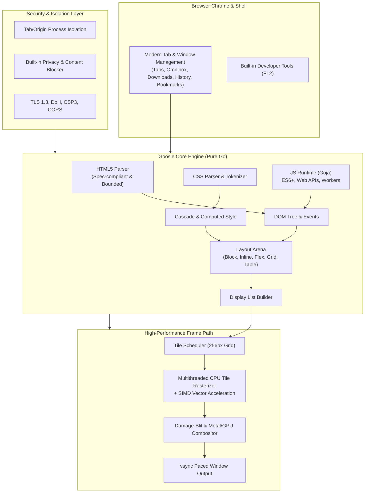
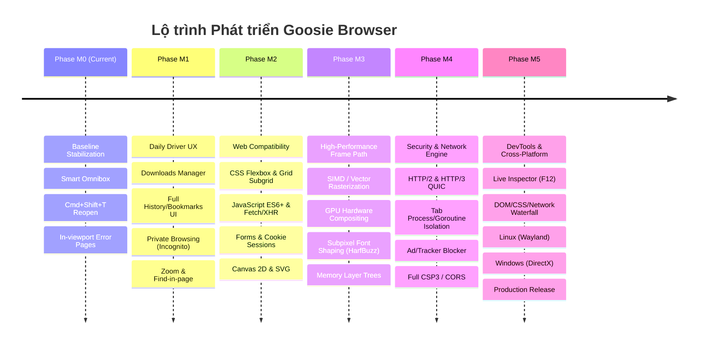

# Goosie Browser — Master Product Roadmap
*Xây dựng Trình duyệt Web Hiện đại, Hiệu năng cao thuần Go (Local-First, High-Performance Go Browser)*

---

## 1. Tầm nhìn Sản phẩm (Product Vision)

**Goosie** là một trình duyệt web độc lập, hiện đại, bảo mật và hiệu năng cực cao, được xây dựng với engine riêng bằng ngôn ngữ **Go**. 

Không sử dụng wrapper Chromium hay WebKit nhúng, Goosie sở hữu toàn bộ pipeline:
**Parse (HTML5) → Style (CSS3 Cascade) → Layout (Arena Engine) → Paint (Display List) → Raster (Tile Worker Pool) → Composite (Damage-Blit / GPU).**

---

## 2. Lộ trình Triển khai Tổng thể (Phase M0 -> M5)

---

## 3. Chi tiết Từng Giai đoạn Phát triển

### Giai đoạn M0: Nền tảng Điều hướng & Tab Hoàn chỉnh *(Đang triển khai)*
**Mục tiêu**: Trình duyệt có thể mở bất kỳ URL/từ khóa nào, xử lý tab mượt mà, không crash khi gặp trang nặng hoặc lỗi mạng.
- **M0.1 - Smart Omnibox**: Tự động phân loại FQDN, domain có TLD, IP, localhost:port và từ khóa tìm kiếm. Hỗ trợ Unicode (tiếng Việt có dấu).
- **M0.2 - Quản lý Tab nâng cao**: Phím tắt `Cmd+Shift+T` mở lại tab vừa đóng (giữ URL, scroll position và history stack); kéo thả sắp xếp tab; overflow scrollbar khi mở nhiều tab.
- **M0.3 - Navigation State & Error Page**:
  - Disable nút Back/Forward khi chạm đáy history.
  - Trang báo lỗi mạng, lỗi TLS/Certificate, lỗi timeout hiển thị trực tiếp trên giao diện trình duyệt thay vì chỉ log console.
- **M0.4 - Gợi ý thông minh (Suggestions Popup)**: Dropdown gợi ý từ lịch sử duyệt web và bookmark ngay khi người dùng nhập trên thanh địa chỉ.

---

### Giai đoạn M1: Hoàn thiện Trải nghiệm Duyệt Web Hằng ngày (Daily Driver UX)
**Mục tiêu**: Cung cấp đầy đủ công cụ quản lý dữ liệu cá nhân, tải file và kiểm soát riêng tư.
- **M1.1 - Download Manager**:
  - Panel hiển thị tiến độ tải file, tốc độ, dung lượng còn lại.
  - Tạm dừng (Pause), tiếp tục (Resume), hủy tải (Cancel).
  - Tự động phát hiện collision tên file; nút "Show in Finder" / "Open file".
- **M1.2 - Bookmark & History Manager (`goosie://bookmarks`, `goosie://history`)**:
  - Giao diện tra cứu lịch sử, tìm kiếm nhanh theo ngày/tên miền, xóa lịch sử tùy chọn.
  - Quản lý bookmark theo thư mục, thanh bookmark bar dưới thanh địa chỉ.
- **M1.3 - Chế độ Riêng tư (Private Browsing / Incognito Window)**:
  - Cửa sổ ẩn danh với Cookie Jar riêng biệt lưu trên RAM (ephemeral).
  - Không ghi lịch sử, cache hay session vào đĩa.
  - Giao diện dark-theme đặc trưng cho cửa sổ riêng tư.
- **M1.4 - Thao tác Đọc & Xem Trang**:
  - Thanh tìm kiếm nội dung (Find in Page - `Cmd+F`) có số lượng kết quả, nút Next/Prev và cuộn tới vị trí tìm thấy.
  - Zoom trang (`Cmd +`, `Cmd -`, `Cmd 0`) kèm chỉ số % zoom trên thanh địa chỉ.

---

### Giai đoạn M2: Tương thích Web Hiện đại (CSS3, DOM & JavaScript)
**Mục tiêu**: Đọc tốt các website tin tức, tài liệu, blog, mạng xã hội nhẹ, hỗ trợ form đăng nhập và tương tác script.
- **M2.1 - Layout Engine Nâng cao**:
  - **CSS Flexbox**: Hỗ trợ đầy đủ `flex-wrap`, `align-content`, nested flex auto-margins.
  - **CSS Grid**: Template areas, `minmax()`, `auto-fill`, `auto-fit`, fractional units (`1fr`), `gap`.
  - **Inline & Typography**: Bidi (RTL/LTR), ngắt dòng tự nhiên (`word-break`, `hyphens`), `text-overflow: ellipsis`.
  - **CSS Selectors Level 4**: `:has()`, `:is()`, `:where()`, attribute matching regex.
  - **Transitions & Animations**: CSS Keyframes và Transition chạy mượt qua vsync animation controller.
- **M2.2 - JavaScript Engine & Web APIs**:
  - Nâng cấp runtime Goja: Hỗ trợ Promise, `async/await`, ES6 classes, Map/Set.
  - **Web APIs**: `fetch()`, `FormData`, `URLSearchParams`, `AbortController`, `Blob`, `FileReader`.
  - **DOM Events**: Full bubbling/capturing phase, mouse/keyboard/wheel/touch/pointer events, form validation API.
  - **Web Storage**: `localStorage` và `sessionStorage` phân lập theo origin.
- **M2.3 - Vector Graphics & Form Controls**:
  - Hỗ trợ thẻ `<svg>` và đường dẫn vector `<path>`, `<circle>`, `<rect>` vẽ trực tiếp vào paint list.
  - Điều khiển biểu mẫu hoàn chỉnh: `<input type="text|password|checkbox|radio|date">`, `<select>`, `<textarea>`.

---

### Giai đoạn M3: Đột phá Hiệu năng (High-Performance Frame Path & GPU Compositing)
**Mục tiêu**: Đạt tốc độ 60-120 FPS mượt mà, phản hồi cuộn trang tức thì, tiêu thụ RAM thấp hơn 50% so với Chrome.
- **M3.1 - Tối ưu Hóa Rasterizer Đa luồng**:
  - Work-stealing worker pool chia đều 256px tiles cho tất cả các CPU cores.
  - Tăng tốc SIMD cho vector path rasterization và chuyển đổi màu sắc (RGBA premultiplication).
- **M3.2 - Hardware-Accelerated Compositing (Tăng tốc Phần cứng)**:
  - Chuyển từ CPU damage-blit thuần sang GPU Compositor (sử dụng **Metal** trên macOS, **Vulkan** trên Linux).
  - Tách các lớp compositing riêng cho các phần tử có `position: fixed`, `overflow: scroll`, `will-change: transform`.
- **M3.3 - Subpixel Text Rendering & Font Shaping**:
  - Tích hợp bộ font shaping chuyên sâu (hỗ trợ CJK tiếng Nhật/Trung/Hàn, chữ Ả Rập, Emoji màu).
  - Font glyph cache đa tầng tránh raster lại các ký tự đã vẽ.
- **M3.4 - Memory Arena & Caching**:
  - Arena slab tái sử dụng bộ nhớ layout box giữa các frame, giảm Garbage Collection (GC) pauses xuống dưới 1ms.
  - Tile LRU cache thông minh tự giải phóng các tile khuất ngoài màn hình khi vượt ngân sách 64 MiB.

---

### Giai đoạn M4: Bảo mật Đa tiến trình & Mạng Thế hệ mới (Security & Network Engine)
**Mục tiêu**: Trở thành trình duyệt an toàn tuyệt đối, bảo vệ quyền riêng tư người dùng mặc định.
- **M4.1 - Kiến trúc Cách ly (Process / Goroutine Sandbox Isolation)**:
  - Mỗi tab chạy trong một ngữ cảnh bộ nhớ được kiểm soát nghiêm ngặt; tab crash không làm sập trình duyệt.
  - Chặn triệt để các lỗ hổng SSRF qua dial-time private address guard.
- **M4.2 - Mạng Tốc độ cao (HTTP/2 & HTTP/3 QUIC)**:
  - HTTP/2 multiplexing tải song song tài nguyên trên 1 TCP connection.
  - HTTP/3 over QUIC (UDP) giảm độ trễ kết nối 0-RTT và khắc phục nghẽn packet loss.
  - DNS-over-HTTPS (DoH) mã hóa toàn bộ truy vấn tên miền.
- **M4.3 - Bảo mật Web Chuẩn công nghiệp**:
  - Content Security Policy (CSP Level 3), Subresource Integrity (SRI), HSTS.
  - Kiểm soát Cookie nghiêm ngặt (`SameSite=Lax/Strict`, `Secure`, `HttpOnly`, Partitioned Cookies).
- **M4.4 - Bộ chặn Quảng cáo & Mã theo dõi Tích hợp (Built-in Privacy Guard)**:
  - Tích hợp engine lọc nội dung (hỗ trợ EasyList/EasyPrivacy) viết thuần Go với thuật toán matching Bloom Filter / Trie cực nhanh.

---

### Giai đoạn M5: Bộ Công cụ Lập trình viên & Đa nền tảng (DevTools & Cross-Platform)
**Mục tiêu**: Đưa Goosie thành trình duyệt hoàn thiện dành cho cả người dùng phổ thông lẫn lập trình viên web.
- **M5.1 - Built-in DevTools (F12 / Cmd+Opt+I)**:
  - **Elements Panel**: Xem cây DOM động, chỉnh sửa thuộc tính real-time, inspect Computed Style và Box Model.
  - **Console Panel**: Nhật ký log, xem lỗi JS, REPL interactive command line.
  - **Network Panel**: Biểu đồ thác nước (waterfall timing), kiểm tra headers, payload, response preview.
  - **Performance / Memory Panel**: FPS counter, đo thời gian Style/Layout/Paint, thống kê tile memory.
- **M5.2 - Đa Nền tảng (Cross-Platform Window Surfaces)**:
  - **Linux**: Hỗ trợ Wayland và X11 thông qua surface protocol thuần Go.
  - **Windows**: Hỗ trợ DirectComposition / WinUI backend.
- **M5.3 - Packaging & Production Release**:
  - macOS: `.dmg` và `.app` bundle có ký số (Code Signing & Notarization bởi Apple).
  - Cơ chế tự động cập nhật an toàn (Auto-updater).
  - Bộ benchmark công khai đọ sức với Chromium/WebKit trên bộ test chuẩn WPT và Speedometer 3.0.

---

## 4. Tiêu chuẩn Đánh giá Chất lượng (QA Quality Gates)

Mỗi tính năng trước khi sáp nhập (merge) vào mã nguồn chính phải vượt qua:

1. **Gate 1 - Architecture Integrity**: `go test ./internal/archtest/` pass 100% (không vi phạm import rules, không mutable globals).
2. **Gate 2 - Memory & Race Safety**: `go test -race ./...` sạch sẽ, không có data race hay goroutine leak.
3. **Gate 3 - Security Bounds**: Mọi dữ liệu không tin cậy phải qua admission checks và `Session.PaintChecked`.
4. **Gate 4 - Visual Parity**: Đạt tỷ lệ tương đồng pixel mong đợi khi chạy so sánh headless với Chromium (`testdata/render/`).
5. **Gate 5 - Frame Rate Budget**: Duy trì 60 FPS trong các kịch bản cuộn trang và animation, không rớt frame.
