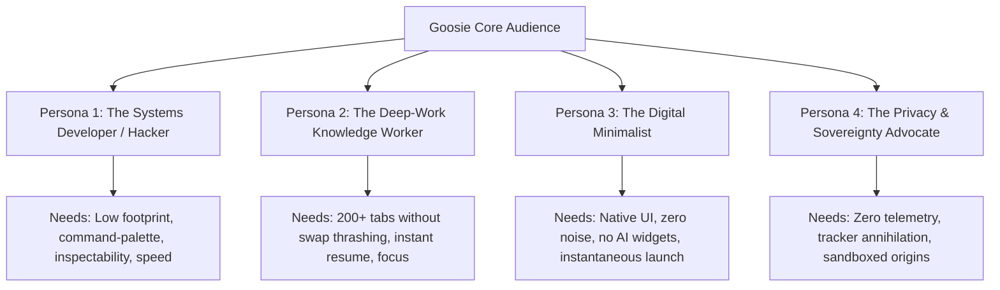
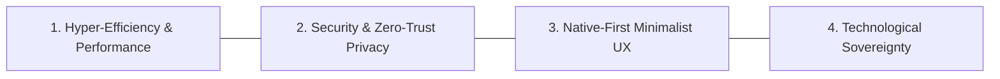
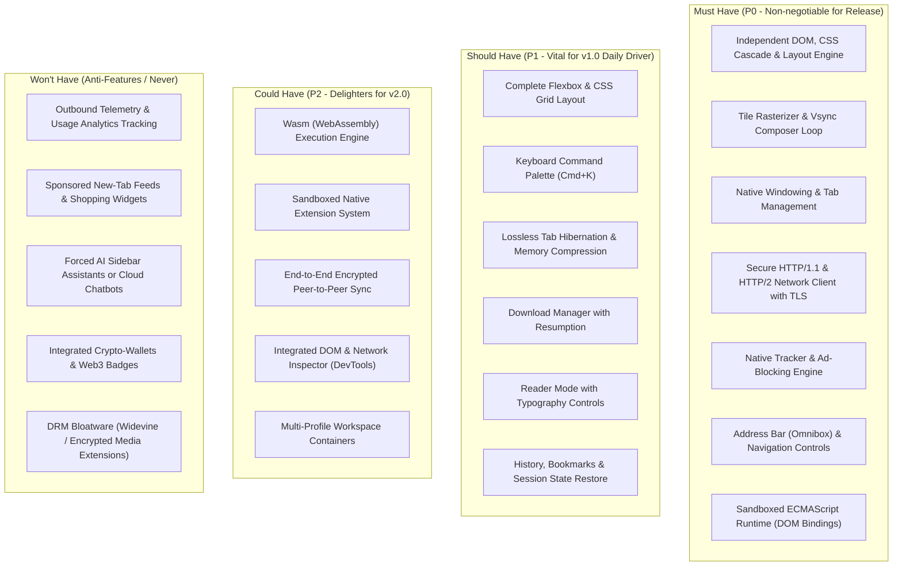
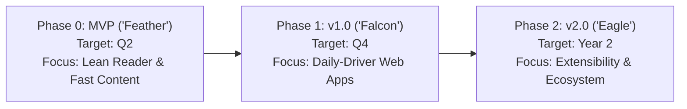
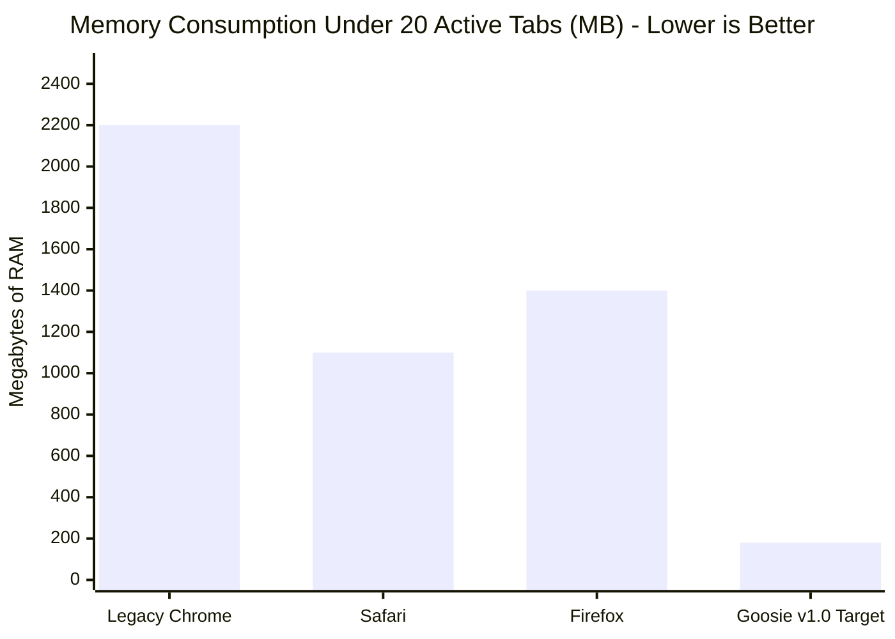
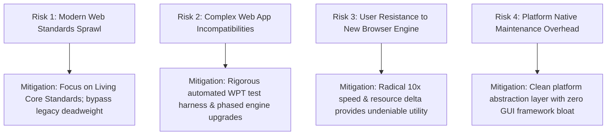

# Goosie Browser: Product Charter & Strategic Vision

**Document Version:** 1.0.0  
**Author:** Product Owner (PO) Team  
**Status:** Approved & Baseline  
**Classification:** Product Definition & Strategy  

---

## 1. Executive Summary & Project Background

### 1.1 The State of the Modern Web Browser
Over the past two decades, the web browser has evolved from a lightweight document viewer into the world's most ubiquitous operating system runtime. However, this evolution has come at a staggering cost to user autonomy, system performance, and technological diversity:

1. **Chromium Monoculture & Engine Centralization:** Over 80% of global web traffic runs on Google's Blink/Chromium engine. This monoculture dictates web standards, suppresses alternative paradigms, and creates an inescapable advertising-first design bias across the internet ecosystem.
2. **Codebase Megalomania & Resource Bloat:** Mainstream browser engines contain upwards of 35 million lines of legacy C/C++ code. A clean installation requires gigabytes of disk space and consumes between 800MB and 2GB of RAM just to maintain an idle state with a handful of tabs, choking CPU cycles and draining laptop batteries.
3. **Surveillance Architecture & Telemetry Sprawl:** Modern commercial browsers have turned into tracking conduits. Deep telemetry hooks, user behavior profiling, embedded shopping assistants, unwanted crypto-wallets, sponsored bookmarks, and invasive AI sidebars are continually forced onto users without meaningful consent.
4. **Latency & Sluggish Native Experience:** Built primarily with cross-platform web technologies or legacy wrappers, modern browsers have lost the crisp, instantaneous responsiveness of true native client software. Input latency, sluggish window resizing, and janky frame pacing have become normalized.

### 1.2 The Goosie Thesis
**Goosie Browser** is conceived from Day 1 as an uncompromising, clean-slate, native-first web browser designed to reclaim the speed, efficiency, and sovereign dignity of personal computing.

By rethinking the browser architecture from zero:
- We treat the browser not as a bloated ad-delivery engine, but as an **ultra-lean, high-precision viewport and execution engine for information and web applications**.
- We construct an independent, modern engine built in a memory-safe, concurrency-native language (Go), pairing a modern box layout and DOM model with a predictable, hardware-paced tile rasterizer and composer.
- We reject surveillance capitalism: Goosie operates with **zero telemetry by default**, built-in tracker annihilation, and sovereign user privacy.

---

## 2. Product Vision, Mission & Core Value Propositions

### 2.1 Vision Statement
> *"To restore the web to its rightful owners: empowering humans with an instantaneous, bloat-free, and sovereign window into global knowledge, without compromise on performance or privacy."*

### 2.2 Mission Statement
> *"Build the world's leanest, fastest, and most trustworthy native browser: launching in milliseconds, sipping megabytes of memory, rendering web standards with mathematical fidelity, and putting the user in absolute command of their computer."*

### 2.3 The 10x Value Proposition Matrix

| Dimension | Legacy Browsers (Chrome / Edge) | Alternative Browsers (Safari / Firefox) | **Goosie Browser (Our Day-1 Standard)** |
| :--- | :--- | :--- | :--- |
| **Engine Independence** | Chromium monopoly; Blink engine driven by Google ad interests | WebKit (Apple locked) / Gecko (Mozilla, heavily funded by search deals) | **100% Independent, sovereign engine** designed for lean concurrency and determinism. |
| **Cold Startup Latency** | 800ms – 2,500ms | 400ms – 1,200ms | **< 80ms** (Instantaneous window appearance and frame readiness). |
| **Base Memory Footprint** | 600MB – 1.5GB idle | 350MB – 800MB idle | **< 30MB base / < 20MB per content tab**. |
| **Telemetry & Privacy** | Ubiquitous telemetry, device fingerprinting, user ID tracking | Good tracking protection, but sends crash/telemetry pings | **Zero telemetry by design**; network-level and DOM-level tracker neutralization built-in. |
| **User Interface Philosophy**| Cluttered, promotional, shopping widgets, unwanted feeds | Minimalist (Safari) to increasingly commercialized | **Hyper-minimalist, native OS ergonomics**, keyboard-driven, distraction-free. |
| **Predictable Pacing** | Intermittent micro-stutters from GC & layout thrashing | Solid, but unpredictable under heavy DOM trees | **Rigid 60/120 FPS vsync pacing** via fixed 256px tile rasterization & damage-blit composer. |

---

## 3. Target Audience & Detailed User Personas

Goosie targets power users, knowledge workers, and technical professionals who feel alienated by mainstream browser bloat and seek an uncompromising productivity tool.

---

### Persona 1: The Systems Developer / Hacker ("Alex")
* **Profile:** 29-year-old Senior Software Engineer / DevOps Architect working on macOS and Linux workstations.
* **Current Frustrations:** 
  - Chrome eats 6GB of RAM while running local Docker containers, IDEs, and compilers.
  - Background browser processes randomly spike CPU, spinning fans during compilation.
  - Bloated devtools with thousands of unused features that lag under heavy logging.
* **Jobs To Be Done (JTBD):**
  > *"When I am developing complex software and researching documentation, I want a browser that starts in under a blink and never consumes more than 5% of my system resources, so that my development workstation remains responsive and cold."*
* **Key Feature Demands:**
  - Fast keyboard-first navigation (Vim-style or Command-K launcher).
  - Lightweight DOM/Network inspector with zero overhead.
  - Deterministic memory capping per tab.

---

### Persona 2: The Deep-Work Knowledge Worker ("Elena")
* **Profile:** 36-year-old Quantitative Researcher / Academic Writer managing deep multi-threaded investigations.
* **Current Frustrations:**
  - Maintains 150+ tabs across 8 topic clusters; browser frequently crashes or reloads tabs unexpectedly, losing form inputs and reading positions.
  - Battery life drops by 40% when the browser is open in the background.
* **Jobs To Be Done (JTBD):**
  > *"When I am cross-referencing hundreds of academic papers, articles, and data consoles, I want tabs to hibernate losslessly and awaken in milliseconds, so that I can organize massive research without system slowdown or battery anxiety."*
* **Key Feature Demands:**
  - Transparent tab hibernation with instantaneous zero-loss restoration.
  - Clean Reader View with zero layout clutter or autoplay distractions.
  - Workspace/Session grouping without complex extension bloat.

---

### Persona 3: The Digital Minimalist ("Julian")
* **Profile:** 42-year-old Product Designer & Writer who values craftsmanship and calm computing.
* **Current Frustrations:**
  - Modern browsers push "New Tab" news feeds, sponsored shopping shortcuts, weather widgets, and intrusive "Try our AI!" buttons.
  - UI looks like a ported web app rather than a first-class citizen on their desktop OS.
* **Jobs To Be Done (JTBD):**
  > *"When I open my browser to read or write, I want a tranquil, invisible interface that adheres strictly to native operating system design standards, so that I can maintain uninterrupted focus on my thoughts."*
* **Key Feature Demands:**
  - Pure native window chrome, dark/light dynamic appearance matching OS settings.
  - Zero default clutter on the new tab page (clean typography or customizable empty state).
  - Total absence of corporate promotional prompts.

---

### Persona 4: The Privacy & Sovereignty Advocate ("Maya")
* **Profile:** 31-year-old Security Researcher & Freedom-of-Information Journalist.
* **Current Frustrations:**
  - Major browsers silently transmit telemetry, hardware GUIDs, and search terms to corporate servers.
  - Ad-blockers are continually neutered by browser vendors (e.g., Manifest V3 restrictions).
* **Jobs To Be Done (JTBD):**
  > *"When I browse sensitive content or communicate across the open web, I want absolute mathematical certainty that no telemetry leaves my machine and no tracking script executes, so that my identity and research remain sovereign."*
* **Key Feature Demands:**
  - Hardened origin isolation and network sandboxing.
  - Native content-blocking engine built directly into the network pipeline before socket connect.
  - Zero external telemetry endpoints compiled into the product.

---

## 4. Core Product Pillars

Goosie's architecture and product decisions are governed by four foundational pillars. If a proposed feature or technical compromise conflicts with these pillars, it is rejected.

### Pillar 1: Hyper-Efficiency & Ultra-High Performance
* **Cold Boot Under 80ms:** From binary invocation to first interactive paint in less than 80 milliseconds.
* **Deterministic Resource Budgets:** Strict per-document admission limits. Max 30MB base application memory; max 25MB per standard content tab.
* **Predictable Vsync Pacing:** Frame path driven by CPU/GPU synchronized tile rasterization and damage-blit composition. No dropped frames during 60/120Hz continuous scrolling.
* **Zero Idle CPU Drain:** When tabs are in the background and no media is playing, CPU utilization must be flat 0.00%.

### Pillar 2: Security & Zero-Trust Privacy by Architecture
* **Zero Outbound Telemetry:** No analytics pings, no crash uploaders unless explicitly requested by the user with full inspectable payload diffs, no identifier generation.
* **Native Kernel-Level Content Blocking:** Built-in network gatekeeper intercepting tracking domains, CNAME cloaking, and ad scripts at the DNS/socket admission layer before parsing bytes.
* **Untrusted Input Hardening:** Strict admission boundaries on image decoders, HTML parsers, and stylesheet allocations. Any malformed or oversized payload is rejected safely without buffer vulnerabilities or OOM crashes.
* **Partitioned State Storage:** Storage, cookies, cache, and service records strictly partitioned per top-level origin to eliminate cross-site tracking vectors.

### Pillar 3: Native-First, Minimalist Ergonomics
* **Respect the OS Canvas:** Built directly against native windowing APIs (macOS Cocoa/AppKit, Linux Wayland/X11, Windows Win32/DirectX). No sluggish cross-platform UI frameworks (no Electron, no Fyne, no Qt bloat).
* **Keyboard-Centric Velocity:** Instant Command-Palette (`Cmd+K` / `Ctrl+K`) for switching tabs, executing actions, querying history, and toggling settings without mouse traversal.
* **Content Is the Hero:** Chrome elements recede when not needed. Maximum viewport-to-window area ratio. Zero promotional widgets, no shopping sidebars, no forced feeds.

### Pillar 4: Technological Sovereignty & Radical Simplicity
* **Clean-Slate Independent Engine:** Complete freedom from the legacy burdens and corporate agendas of Chromium/WebKit.
* **Modern Web Standards Focus:** Prioritize living web standards (HTML5, modern CSS Layout, ECMAScript) while discarding obsolete legacy bloat (Flash, ActiveX, legacy quirks, redundant vendor extensions).
* **Maintainable, Comprehensible Architecture:** Designed with clear modular boundaries, strictly enforced dependency graphs, and clean concurrency primitives.

---

## 5. Epics & MoSCoW Feature Prioritization

Features are categorized using the MoSCoW framework across project phases.

### Detailed MoSCoW Prioritization Table

| Priority | Epic | Feature Description | Milestone | Rationale / Value |
| :--- | :--- | :--- | :--- | :--- |
| **Must Have** | **Core Engine** | HTML5 Tree Construction & DOM Living Standard | MVP | Fundamental basis for web page document parsing. |
| **Must Have** | **Core Engine** | CSS Tokenizer, Selector Engine & Cascade Resolution | MVP | Essential for visual document fidelity. |
| **Must Have** | **Layout** | Block, Inline, Float, Table & Absolute Positioning Box Model | MVP | Foundation for rendering 90%+ of standard content web pages. |
| **Must Have** | **Frame Path** | Fixed 256px Tile Rasterizer & Worker Pool with Damage Blit | MVP | Guarantees non-blocking 60fps rendering without memory explosion. |
| **Must Have** | **Platform** | Native macOS Cocoa/Metal Window Frame & Event Dispatch | MVP | Zero-overhead native OS integration. |
| **Must Have** | **Networking** | TLS 1.3, HTTP/1.1, HTTP/2 Client with Connection Pooling | MVP | Secure, modern network data transmission. |
| **Must Have** | **Privacy** | Native Network Ad & Tracker Blocker (Filter-list based) | MVP | Core brand promise: tracker annihilation at zero latency. |
| **Must Have** | **Chrome** | Tab Strips, Tab Creation/Closure, URL Omnibox, Back/Forward | MVP | Baseline browser human interface contract. |
| **Must Have** | **JS Engine** | Sandboxed JavaScript Execution Engine with DOM Events | MVP | Necessary for dynamic web pages, login flows, and navigation. |
| **Should Have**| **Layout** | Full CSS Flexbox & CSS Grid Layout Engine | v1.0 | Unlocks modern web applications and complex responsive designs. |
| **Should Have**| **Experience** | Instant Command Palette (`Cmd+K`) for All Actions | v1.0 | Core differentiator for power users and developers. |
| **Should Have**| **Memory** | Predictive Tab Hibernation & Compressed State Eviction | v1.0 | Enables 500+ open tabs with < 100MB active memory. |
| **Should Have**| **Downloads** | Native Download Manager with Auto-resume & Checksums | v1.0 | Essential utility for daily-driver use. |
| **Should Have**| **Content** | High-Legibility Distraction-Free Reader Mode | v1.0 | Delivers on the calm, minimalist reading experience. |
| **Should Have**| **State** | Crash-Resilient Session Restore & SQLite Bookmarks/History | v1.0 | Prevents data loss; allows seamless restart across reboots. |
| **Could Have** | **Engine** | WebAssembly (Wasm) MVP Execution Sandbox | v2.0 | Enables high-performance client tools (Figma, compilers). |
| **Could Have** | **Extension** | Secure, Sandboxed Micro-Extension API (Content Modifiers) | v2.0 | Allows custom user scripting without opening security holes. |
| **Could Have** | **Sovereignty**| End-to-End Encrypted (E2EE) Sync via User-Owned Storage | v2.0 | Sync bookmarks/history across devices without central servers. |
| **Could Have** | **DevTools** | Minimalist DOM Tree & Network Waterfall Inspector | v2.0 | Enables developers to debug without launching heavyweight browsers. |
| **Won't Have** | **Surveillance**| Corporate Usage Telemetry, Crash Pingback without consent | **NEVER** | Violates Core Pillar 2 (Zero-Trust Privacy). |
| **Won't Have** | **Bloat** | Sponsored News Feed, Weather, Shopping Coupons on New Tab | **NEVER** | Violates Core Pillar 3 (Minimalist Ergonomics). |
| **Won't Have** | **Gimmick** | Built-in LLM Sidebar / AI Chatbot | **NEVER** | Bloats binary, leaks user context, breaks focus. |
| **Won't Have** | **Fintech** | Crypto-Wallets, NFT Viewers, Sponsored Token Integrations | **NEVER** | Irrelevant to web browsing; major security attack surface. |

---

## 6. Release Roadmap & Milestones

The product execution strategy is organized into three sequential, highly gated release milestones:

---

### Milestone 0: MVP ("Feather") — The Ultra-Lean Content Browser
* **Primary Objective:** Deliver a lightning-fast, ultra-stable, native content browser capable of rendering news sites, blogs, documentation, and technical portals with near-zero resource consumption.
* **Target Audience:** Technical early adopters, developers, and digital minimalists.
* **Core Capabilities & Deliverables:**
  - Fast HTML5 parser and DOM tree construction.
  - Core CSS styling (Cascade, selectors, typography, colors, borders, margins, padding).
  - Box layout arena (Block, Inline, Table basics, Floats).
  - 256px tile CPU rasterization pipeline with multithreaded worker pool.
  - Native Cocoa/macOS window shell with tabs, Omnibox, and history navigation.
  - Hardened network client with TLS 1.3 and built-in ad/tracker blocklist.
  - Untrusted input defense: hard limits on image decodes, token streams, and DOM nodes.
* **Release Gates / Exit Criteria:**
  - [ ] Cold launch time < 150ms on M-series Mac hardware.
  - [ ] Idle baseline memory footprint < 30MB; 5 open content tabs < 120MB total.
  - [ ] Zero crash on the top 1,000 WPT (Web Platform Tests) basic layout suite.
  - [ ] Strict import architecture validation passing with 0 circular dependencies or banned packages.
  - [ ] Zero telemetry network packets emitted during 24 hours of active operation.

---

### Milestone 1: v1.0 ("Falcon") — The Sovereign Daily Driver
* **Primary Objective:** Upgrade Goosie into a primary desktop daily driver capable of supporting complex interactive web applications, modern responsive layouts, and full media streaming.
* **Target Audience:** General knowledge workers, researchers, full-time developers.
* **Core Capabilities & Deliverables:**
  - Modern CSS Layout: Full CSS Flexbox and CSS Grid layout algorithms.
  - Integrated Sandboxed JavaScript Engine supporting ES2020+ standards, DOM event loop, and Fetch API.
  - Dynamic Form Controls (Inputs, selects, textareas, file pickers) and state handling.
  - Lossless Tab Hibernation: Auto-eviction of background tab memory with instantaneous scroll-state restoration.
  - Power-User Command Palette (`Cmd+K`) for instantaneous tabs, history, and actions.
  - High-Fidelity Reader Mode with customizable typography, width, and theme.
  - Robust SQLite-backed History, Bookmarks, and Crash Recovery Session Store.
* **Release Gates / Exit Criteria:**
  - [ ] Cold launch time < 80ms; Warm launch < 25ms.
  - [ ] 100+ concurrent open tabs consume < 250MB active RAM through intelligent hibernation.
  - [ ] 60 FPS / 120 FPS frame pacing on continuous scrolling across top 100 web portals.
  - [ ] 95%+ pass rate on modern CSS Flexbox and Grid conformance suites.
  - [ ] Mean Time Between Failures (MTBF) exceeding 150 hours of intensive daily usage.

---

### Milestone 2: v2.0 ("Eagle") — Extensible Sovereign Platform
* **Primary Objective:** Expand Goosie into an extensible, private computing environment supporting user extensions, encrypted multi-device sync, and developer tooling.
* **Target Audience:** Systems engineers, security researchers, and privacy power users.
* **Core Capabilities & Deliverables:**
  - Sandboxed WebAssembly (Wasm) execution runtime for high-performance web tooling.
  - Goosie Micro-Extension API: Safe, isolated user scripts and styling extensions without DOM permission vulnerabilities.
  - End-to-End Encrypted (E2EE) Sync: Zero-knowledge peer-to-peer sync of bookmarks, history, and settings via user-defined WebDAV or cloud storage.
  - Lightweight Native Developer Tools: Deep-inspection DOM inspector, console, and network waterfall.
  - Contextual Container Profiles: Strict isolation of cookies, cache, and state across personal, work, and banking sessions in a single window.
* **Release Gates / Exit Criteria:**
  - [ ] Extension sandbox introduces zero measurable latency to the primary frame pipeline.
  - [ ] Zero leak of profile data across partitioned container boundaries.
  - [ ] Wasm execution within 1.3x of native C performance benchmarks.
  - [ ] Zero data corruption across 10,000 simulated network-interrupted sync operations.

---

## 7. Success Metrics & Key Performance Indicators (KPIs)

To guarantee objective accountability, product success is evaluated against four quantitative metric clusters:

### 7.1 Performance & Resource KPIs (Non-Negotiable Budgets)

| Metric | Measurement Method | Industry Benchmark (Chrome/Safari) | **Goosie MVP Target** | **Goosie v1.0 Target** |
| :--- | :--- | :--- | :--- | :--- |
| **Cold Startup Time** | Invocation to first interactive frame | 800ms – 1,800ms | **< 150ms** | **< 80ms** |
| **Warm Startup Time** | Re-launching cached instance | 300ms – 600ms | **< 50ms** | **< 20ms** |
| **Base App Memory (Idle)**| 1 empty window / start page | 300MB – 650MB | **< 30MB** | **< 20MB** |
| **RAM per Content Tab** | Standard Wikipedia / News article | 120MB – 250MB | **< 25MB** | **< 15MB** |
| **100 Background Tabs RAM**| Hibernated background tabs | 3,000MB – 6,000MB | **N/A (MVP)** | **< 200MB total** |
| **Frame Pacing (Scrolling)**| Vsync interval hit rate | 85% – 94% (jittery) | **> 98.0%** | **> 99.5% (60/120Hz)** |
| **CPU Utilization (Idle)**| 5 background tabs, no active media | 1.5% – 6.0% | **0.00%** | **0.00%** |

### 7.2 Reliability & Engineering Quality KPIs
* **Crash Rate per 1,000 Sessions:** Target `< 0.05%` (equivalent to fewer than 1 crash per 20,000 browsing sessions).
* **Memory Leak Cleanliness:** 0 bytes leaked over a 48-hour continuous headless soak test exercising 50,000 page navigations.
* **Untrusted Input Resilience:** 100% rejection rate of maliciously oversized images (e.g., decompression bombs > 16k x 16k) without parent process failure.
* **Architecture Integrity:** 100% compliance with allowed package import graphs via automated CI architecture tests (`internal/archtest`).

### 7.3 User Adoption & Retention KPIs (Post-Launch)
* **Day-1 to Day-7 Retention:** Target `> 45%` among technical personas (developer/minimalist cohorts).
* **Day-30 Long-Term Habituation:** Target `> 30%` sustaining Goosie as their default browser for non-media workflows.
* **Net Promoter Score (NPS):** Target `> +65` for desktop speed and lack of distraction.
* **Default Browser Conversion:** `> 35%` of users who install and use Goosie for 3 consecutive days set it as the default system browser.

---

## 8. Anti-Goals: What Goosie Will NEVER Be

Clear boundaries preserve product integrity. The following items are explicitly out of scope and prohibited from the product roadmap:

1. **NO Commercial Surveillance or Data Monetization:** We will never collect browsing history, click streams, IP hashes, or sell user telemetry.
2. **NO Proprietary Media DRM Enclaves:** We will not ship proprietary, opaque DRM blobs (such as Google Widevine) that compromise engine inspectability and sovereignty.
3. **NO Cryptocurrency, Web3, or Fintech Features:** No crypto wallets, no token rewards, no distributed token schemes.
4. **NO Content Discovery Networks or Sponsored Feeds:** No news feeds, clickbait carousels, or paid search affiliate link injection on the new tab screen.
5. **NO Intrusive AI Chatbots or Cloud Assistants:** Browsing is an intimate, contemplative act. We will not inject conversational sidebars or cloud LLMs analyzing page contents.

---

## 9. Strategic Risk Assessment & Mitigation

| Risk Factor | Probability | Impact | Mitigation Strategy |
| :--- | :--- | :--- | :--- |
| **Web Standards Sprawl:** Web standards are massive and frequently expanded to benefit Google ad tech. | High | High | Rigorously isolate core HTML/CSS/DOM/ECMAScript standards. Reject proprietary API proposals designed solely for advertising or device fingerprinting. |
| **Site Compatibility Gaps:** Users expect every legacy site to render pixel-identically to Chrome. | High | Medium | Prioritize standard document web and productivity apps first; deploy continuous visual regression testing against Chromium/Playwright fixtures. |
| **JavaScript Performance Ceiling:** Pure Go interpreter may trail Google's multi-tier JIT (V8) on heavy JS apps. | Medium | Medium | Optimize the DOM-to-engine bridge; focus on parallelizing layout, style cascade, and tile rasterization so JavaScript execution never blocks frame pacing. |
| **OS Platform Fragmentation:** Supporting multiple native OS windowing targets requires specialized native code. | Medium | Low | Keep platform-specific code strictly quarantined (`internal/platform/{darwin,linux,windows}`); maintain headless test platform as standard for all CI gates. |

---

## 10. Summary & Day-1 Execution Directive

Goosie Browser is not an incremental skin on Chromium; it is a fundamental return to first principles. By combining:
1. **Engine Independence** (clean-slate memory-safe architecture),
2. **Deterministic Performance** (sub-80ms launch, < 30MB base RAM, fixed tile rasterization),
3. **Absolute Privacy** (native tracker annihilation, zero telemetry), and
4. **Minimalist Craftsmanship** (native OS chrome, keyboard-first velocity),

Goosie delivers a product that is not merely 10% faster, but **10x lighter, cleaner, and more trustworthy** than the incumbent monopolies.

---
*End of Product Charter & Strategy Specification.*
