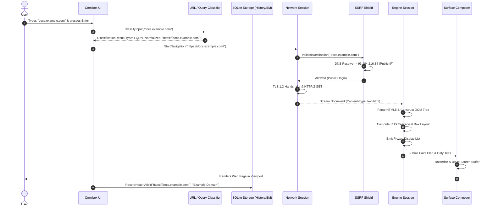
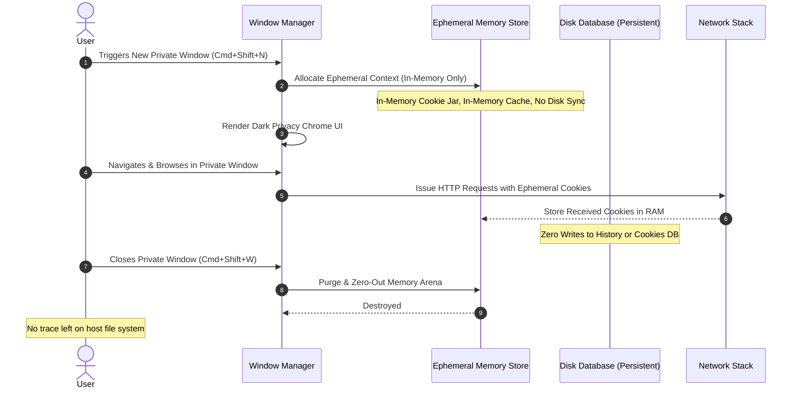
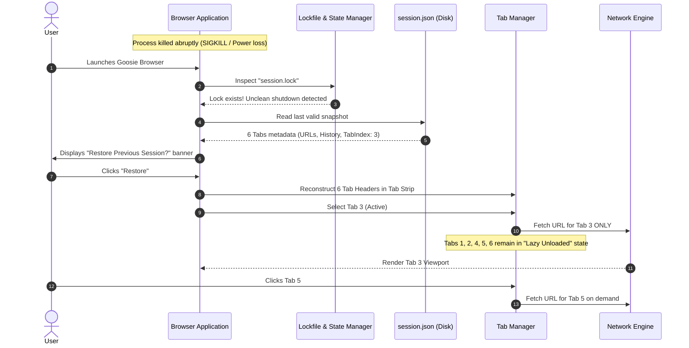
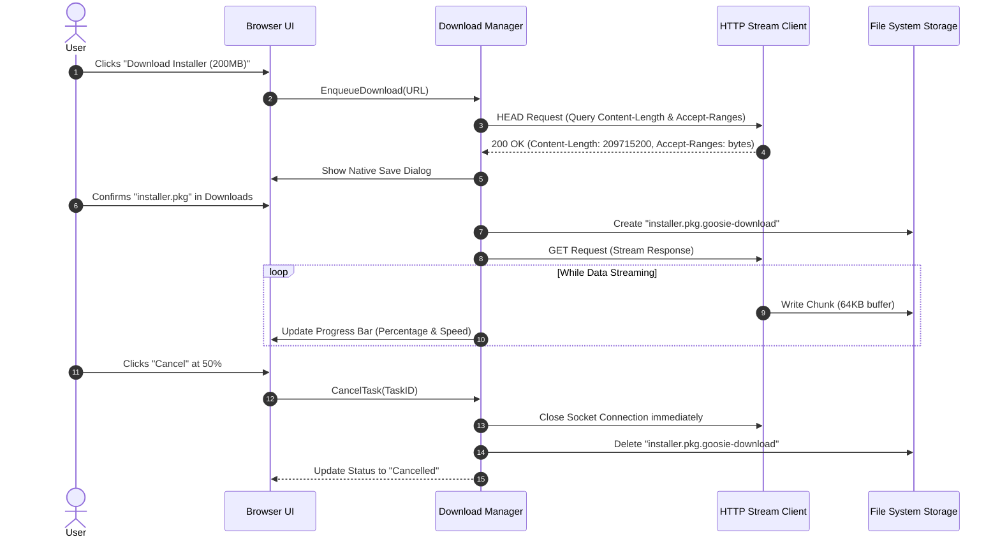

# Goosie Browser: Software Requirements Specification (SRS) & Agile User Stories

| Document Version | 1.0.0-PROD |
| :--- | :--- |
| **Status** | Approved Baseline (Day 1 Greenfield Specification) |
| **Product** | Goosie Browser (High-Performance Desktop Web Engine) |
| **Author** | Lead Technical Business Analyst & Systems Architect |
| **Target Platforms** | macOS (Darwin / Apple Silicon & Intel x86_64), Linux (X11 / Wayland), Windows (DirectX/Win32) |
| **Architecture Classification** | Native Core, Multi-Process / Thread-Isolated Engine, Fixed-Size Tile Rasterizer |

---

## Table of Contents
1. [Executive Summary & Product Vision](#1-executive-summary--product-vision)
2. [Scope & System Boundaries](#2-scope--system-boundaries)
   - 2.1 In-Scope Capabilities (MVP vs. v1.0)
   - 2.2 Explicit Out-of-Scope Capabilities
   - 2.3 System Constraints & Operating Assumptions
3. [System Conceptual Model & Pipeline Architecture](#3-system-conceptual-model--pipeline-architecture)
4. [Functional Requirements (FRs)](#4-functional-requirements-frs)
   - [FR-NAV: Navigation & Omnibox Subsystem](#fr-nav-navigation--omnibox-subsystem)
   - [FR-TAB: Tab & Window Lifecycle Management](#fr-tab-tab--window-lifecycle-management)
   - [FR-RND: Rendering Pipeline & Web Standards](#fr-rnd-rendering-pipeline--web-standards)
   - [FR-JS: JavaScript Runtime & DOM API Subsystem](#fr-js-javascript-runtime--dom-api-subsystem)
   - [FR-AST: Asset & Content Ingestion Pipeline](#fr-ast-asset--content-ingestion-pipeline)
   - [FR-DAT: Local Data, State & Persistence](#fr-dat-local-data-state--persistence)
   - [FR-SEC: Security, Sandboxing & Origin Controls](#fr-sec-security-sandboxing--origin-controls)
5. [Non-Functional Requirements (NFRs)](#5-non-functional-requirements-nfrs)
   - [NFR-PERF: Latency, Startup & Frame Pacing](#nfr-perf-latency-startup--frame-pacing)
   - [NFR-MEM: Memory Budgets & Footprint Caps](#nfr-mem-memory-budgets--footprint-caps)
   - [NFR-LIM: Untrusted Input & Hard Admission Limits](#nfr-lim-untrusted-input--hard-admission-limits)
   - [NFR-REL: Crash Resilience & Reliability](#nfr-rel-crash-resilience--reliability)
   - [NFR-SEC: Hardened Sandboxing & Defense-in-Depth](#nfr-sec-hardened-sandboxing--defense-in-depth)
   - [NFR-BIN: Binary Footprint & Dependency Rules](#nfr-bin-binary-footprint--dependency-rules)
6. [Agile User Stories & Acceptance Criteria (Gherkin)](#6-agile-user-stories--acceptance-criteria-gherkin)
   - [US-01: Smart Omnibox Navigation & Unified Query Disambiguation](#us-01-smart-omnibox-navigation--unified-query-disambiguation)
   - [US-02: Isolated Multi-Tab Lifecycle with Memory Reclamation](#us-02-isolated-multi-tab-lifecycle-with-memory-reclamation)
   - [US-03: Deterministic Session Persistence & Crash Recovery](#us-03-deterministic-session-persistence--crash-recovery)
   - [US-04: Ephemeral Private Browsing Window Isolation](#us-04-ephemeral-private-browsing-window-isolation)
   - [US-05: Stream-Resilient Resumable File Download Manager](#us-05-stream-resilient-resumable-file-download-manager)
   - [US-06: Strict SSRF Defense & Private Network Admission](#us-06-strict-ssrf-defense--private-network-admission)
   - [US-07: Smooth Vsync-Locked Scrolling via Display List Tiling](#us-07-smooth-vsync-locked-scrolling-via-display-list-tiling)
   - [US-08: Bookmark & History Hierarchical Management](#us-08-bookmark--history-hierarchical-management)
7. [Critical System Use Cases & Step-by-Step Interaction Flows](#7-critical-system-use-cases--step-by-step-interaction-flows)
   - [UC-01: Omnibox Navigation, Disambiguation & Document Dispatch](#uc-01-omnibox-navigation-disambiguation--document-dispatch)
   - [UC-02: Ephemeral Private Browsing Window Creation and Tear-down](#uc-02-ephemeral-private-browsing-window-creation-and-tear-down)
   - [UC-03: Multi-Tab Crash Detection & Lazy Session Restore](#uc-03-multi-tab-crash-detection--lazy-session-restore)
   - [UC-04: Streaming Download with Range Requests, Throttling & User Abort](#uc-04-streaming-download-with-range-requests-throttling--user-abort)
8. [Data Models, Entity Schemas & State Specifications](#8-data-models-entity-schemas--state-specifications)
   - 8.1 Bookmarks Schema
   - 8.2 History & Visit Logs Schema
   - 8.3 Cookie Jar & Storage Isolation Schema
   - 8.4 Download Task State Schema
   - 8.5 Browser Configuration & User Preferences Schema
   - 8.6 Tab Session State Snapshot Schema
9. [Traceability Matrix & Release Gate Verification](#9-traceability-matrix--release-gate-verification)

---

## 1. Executive Summary & Product Vision

**Goosie Browser** is a brand-new, modern desktop web browser engineered from the ground up for extreme lightweight execution, determinism, predictability, and memory safety. Unlike existing Chromium-based or WebKit-derivative browsers that consume gigabytes of host RAM and present millions of lines of legacy C++ attack surface, Goosie establishes an independent, lean rendering and script execution pipeline.

### Product Mission
To provide technical users, developers, and resource-constrained environments with a blazingly fast, crash-resilient desktop browser that starts in under 150ms, holds per-tab memory consumption strictly below 30MB, maintains 60/120fps display refresh frame pacing, and strictly mitigates attack vectors (such as SSRF and memory exhaustion) through defensive admission controls.

---

## 2. Scope & System Boundaries

```
+---------------------------------------------------------------------------------------+
|                                    GOOSIE BROWSER                                     |
|                                                                                       |
|  +------------------------+  +------------------------+  +-------------------------+  |
|  |     BROWSER CHROME     |  |   STORAGE & SECURITY   |  |     NETWORK ENGINE      |  |
|  | - Tab Manager          |  | - SQLite Bookmarks     |  | - HTTP/1.1 & HTTP/2     |  |
|  | - Omnibox / History    |  | - SQLite History       |  | - TLS 1.3 Strict Verif. |  |
|  | - Toolbar & Status Bar |  | - Cookie Jar (Origin)  |  | - SSRF Private Guard    |  |
|  | - Download Manager UI  |  | - Session Snapshots    |  | - Stream Download Pipe  |  |
|  +-----------+------------+  +-----------+------------+  +------------+------------+  |
|              |                           |                            |               |
|              +---------------------------+----------------------------+               |
|                                          |                                            |
|                                          v                                            |
|  +---------------------------------------------------------------------------------+  |
|  |                          ENGINE SESSION (PER-TAB ISOLATION)                     |  |
|  |                                                                                 |  |
|  |  +---------------------+   +---------------------+   +-----------------------+  |  |
|  |  |    HTML5 PARSER     |-->|    CSS3 CASCADE     |-->|     LAYOUT ENGINE     |  |  |
|  |  |  - Strict Admission |   |  - Computed Style   |   |   - Arena Allocation  |  |  |
|  |  |  - Tree Depth Guard |   |  - Specificity Calc |   |   - Block/Inline/Flex |  |  |
|  |  +----------+----------+   +---------------------+   +-----------+-----------+  |  |
|  |             |                                                    |              |  |
|  |             v                                                    v              |  |
|  |  +---------------------+                             +-----------------------+  |  |
|  |  |    DOM LEVEL 2/3    |                             |  DISPLAY LIST EMITTER |  |  |
|  |  |  - Event Dispatch   |<=========================== |  - Frozen Layer Tree  |  |  |
|  |  |  - Script Bindings  |    (JS Mutates DOM/Style)   |  - Damage Rect Tracking| |  |
|  |  +----------+----------+                             +-----------+-----------+  |  |
|  |             |                                                    |              |  |
|  |             v                                                    v              |  |
|  |  +---------------------+                             +-----------------------+  |  |
|  |  | JAVASCRIPT RUNTIME  |                             | CPU TILE RASTERIZER   |  |  |
|  |  |  - Isolated Context |                             |  - 256x256 Tile Grid  |  |  |
|  |  |  - Microtask Queue  |                             |  - Thread Worker Pool |  |  |
|  |  |  - Fetch / Timers   |                             |  - Glyph Atlas Cache  |  |  |
|  |  +---------------------+                             +-----------+-----------+  |  |
|  |                                                                  |              |  |
|  +------------------------------------------------------------------|--------------+  |
|                                                                     v                 |
|  +---------------------------------------------------------------------------------+  |
|  |                         SURFACE COMPOSER & VSYNC LOOP                           |  |
|  |  - Native Platform Window (macOS Metal/Quartz, Linux X11/EGL, Win32)            |  |
|  |  - Damage-blit compositor, zero-copy tile swap, 60fps/120fps display lock       |  |
|  +---------------------------------------------------------------------------------+  |
+---------------------------------------------------------------------------------------+
```

### 2.1 In-Scope Capabilities

| Feature Domain | Minimum Viable Product (MVP) | Release v1.0 Target |
| :--- | :--- | :--- |
| **Navigation & UI** | Single window, multi-tab strip, Omnibox with URL auto-complete, Back/Forward/Reload/Stop buttons, Status bar. | Tab reordering via drag-and-drop, Tab pinned states, Tab audio indicators, Bookmark bar, Custom themes. |
| **Document Parsing** | HTML5 compliant tokenization and tree construction, CSS3 selector engine, Box model computation. | Incremental parsing, DOM mutations with dirty-region invalidation, CSS Grid, Media queries (`prefers-color-scheme`, min/max width). |
| **Layout & Styling** | Flow layout (Block, Inline), Float positioning, Fixed and Absolute positioning, Flexbox (standard axes). | CSS Table layout, CSS Grid (explicit tracks), Stacking context 3D z-index tree, Overflow clipping. |
| **Tile Rasterizer** | 256x256 pixel uniform grid, multi-threaded CPU rasterizer, dirty-tile damage tracking, glyph atlas caching. | GPU-accelerated blit/composition, subpixel antialiasing, damage-rect scissor composition. |
| **Script Execution** | Isolated ECMAScript engine, basic DOM manipulation (`getElementById`, `querySelector`, `addEventListener`), `setTimeout`/`setInterval`. | Full event bubbling/capturing, `fetch()` API with streaming responses, Promise/async-await loop, Custom events, LocalStorage. |
| **Networking** | HTTP/1.1 and HTTP/2 over TLS 1.3, Cookie handling, Redirect loops protection, Strict Private IP SSRF Shield. | Brotli/Gzip decompression, HTTP/3 (QUIC) evaluation, Resumable Range HTTP downloads. |
| **Local Persistence** | Atomic SQLite storage for Bookmarks, History, Cookies, and Tab Session configuration. | Full-text search (FTS5) over history, encrypted credentials store, export/import standard Netscape bookmark HTML. |

### 2.2 Explicit Out-of-Scope Capabilities
The following capabilities are deliberately excluded from MVP and v1.0 to preserve lean execution, strict attack surface minimization, and tight memory limits:
1. **WebExtensions / Chrome Extension API**: No NPAPI, Manifest V2/V3 extension runtime.
2. **WebRTC & Peer-to-Peer Media**: No STUN/TURN, UDP media capture, screen sharing, or camera/microphone piping.
3. **DRM / Widevine / Encrypted Media Extensions (EME)**: No proprietary binary blob CDM integration.
4. **WebGPU / WebGL 3D Acceleration**: No direct expose of raw GPU shader execution to untrusted web content.
5. **Built-in PDF / Flash / Java Plugins**: No legacy plugin architectures; external handling or pure HTML canvas fallbacks only.
6. **Built-in Cloud Sync Service**: No proprietary central account sync; all data stored in transparent, local, portable SQLite files.

### 2.3 System Constraints & Operating Assumptions
- **Host Resource Model**: Single-host execution without requiring virtualization or hypervisor-level sandboxing (e.g., microVMs).
- **Tooling Constraints**: Core codebase must compile into a self-contained single native binary without heavy external dynamic runtime links.
- **Displayless Capability**: Engine must be capable of running fully headless for automated conformance testing and visual regression without a physical display server connected.

---

## 3. System Conceptual Model & Pipeline Architecture

The Goosie browser architecture operates as a unidirectional pipeline governed by admission gates:

```
[Network Stream / Disk Stream]
             |
             v
   [ 1. Admission Gate ] ===== (Reject payloads > 50MB, probe image headers)
             |
             v
    [ 2. HTML5 Parser ]
             |
             v
   [ 3. DOM Tree Arena ] <==== [ 3a. JS Runtime (Event Loop / Microtasks) ]
             |
             v
  [ 4. Style Cascade ] ======= (Calculate computed values & rule specificity)
             |
             v
   [ 5. Box Generator ] ====== (Arena layout: Block, Inline, Float, Flex, Grid)
             |
             v
 [ 6. Display List Build ] === (Emit frozen paint commands: fills, borders, glyphs)
             |
             v
 [ 7. Damage Evaluator ] ===== (Calculate dirty tiles intersecting damage rects)
             |
             v
[ 8. Tile Rasterizer Pool ] == (Multithreaded CPU raster to 256x256 pixel bitmaps)
             |
             v
 [ 9. Surface Loop Blit ] ==== (Vsync-locked presentation to native window buffer)
```

---

## 4. Functional Requirements (FRs)

### FR-NAV: Navigation & Omnibox Subsystem

| Req ID | Requirement Statement | Priority | Validation Method |
| :--- | :--- | :--- | :--- |
| **FR-NAV-01** | The Omnibox must accept user text input and determine whether it is a valid URI scheme (`http://`, `https://`, `about:`, `file://`), a valid Fully Qualified Domain Name (FQDN), an IPv4/IPv6 address, or a search term query. | P0 | Automated Unit Tests & URL parser suite |
| **FR-NAV-02** | If the input lacks an explicit scheme and matches standard domain heuristics (contains valid TLD from public suffix list or `localhost`), the system must prepend `https://` by default. | P0 | Automated Integration Test |
| **FR-NAV-03** | If the input does not parse as a valid URI or domain name, the system must formulate a query URL using the user-configured Default Search Engine template (e.g., `https://duckduckgo.com/?q=%s`). | P0 | Functional End-to-End Test |
| **FR-NAV-04** | The Omnibox must display a dropdown with up to 8 real-time suggestions combining local Bookmarks and History match results ranked by Frecency (Frequency + Recency) with debounce timing of 50ms. | P1 | Interactive Parity Test |
| **FR-NAV-05** | The Navigation controller must maintain a deterministic Back/Forward history stack per tab, capping history navigation entries at 50 nodes per session. | P0 | State Invariant Unit Test |
| **FR-NAV-06** | The Navigation controller must implement idempotent **Reload** (re-fetching from network or validating cache) and **Stop** (immediately aborting in-flight network streams and DOM parsing). | P0 | Network Simulation Test |
| **FR-NAV-07** | The browser must support internal synthetic URLs: `about:blank`, `about:version`, `about:settings`, `about:history`, `about:bookmarks`, and `about:downloads`. | P1 | Automated Harness Test |

### FR-TAB: Tab & Window Lifecycle Management

| Req ID | Requirement Statement | Priority | Validation Method |
| :--- | :--- | :--- | :--- |
| **FR-TAB-01** | The Tab Manager must manage an arbitrary number of open tabs, assigning each tab a monotonic `TabID`, an independent navigation controller, and an isolated `Session` instance. | P0 | Stress Testing (100 tabs) |
| **FR-TAB-02** | Creating a tab (`Cmd+T` / `Ctrl+T`) must allocate a new tab in the foreground or background within <= 30ms, defaulting to `about:blank` or home page. | P0 | Performance Benchmark |
| **FR-TAB-03** | Closing a tab (`Cmd+W` / `Ctrl+W`) must cleanly abort all active fetch requests, stop timers, destroy the JS runtime, reclaim DOM arena memory, and release cached tile textures. | P0 | Memory Profiler & Leak Test |
| **FR-TAB-04** | The Tab strip must support tab overflow scroll when the total width of open tabs exceeds window bounds, maintaining a minimum clickable tab width of 80px. | P1 | Visual Layout Test |
| **FR-TAB-05** | The system must provide **Private Browsing** mode. Private tabs must run in an isolated in-memory ephemeral store; zero history, cookies, or cache entries shall be committed to disk. | P0 | File System Forensic Audit |
| **FR-TAB-06** | When available system memory crosses the warning threshold (e.g., < 200MB free host memory), the Tab Manager must discard background tab raster caches and serialize DOM states to disk (Tab Discarding). | P1 | Low Memory Injection Test |

### FR-RND: Rendering Pipeline & Web Standards

| Req ID | Requirement Statement | Priority | Validation Method |
| :--- | :--- | :--- | :--- |
| **FR-RND-01** | The HTML parser must parse HTML5 tokens compliant with WHATWG standards, correctly emitting DOM Elements, Text nodes, and Comments while tolerating malformed tags without crashing. | P0 | WPT (Web Platform Tests) |
| **FR-RND-02** | The CSS engine must parse CSS3 stylesheets, calculate specificity (`Inline > ID > Class/Attr > Element`), resolve inheritance, and compute styles for all matched elements. | P0 | WPT CSS Style Suite |
| **FR-RND-03** | The Box Generator must lay out elements according to CSS display properties: `block`, `inline`, `inline-block`, `none`, and standard flexbox layouts (`flex-direction`, `justify-content`, `align-items`). | P0 | Visual Parity Test |
| **FR-RND-04** | Positioning models must support `static`, `relative`, `absolute`, and `fixed`. Fixed boxes must remain stationary relative to the viewport during scroll operations. | P0 | Headless Snapshot Parity |
| **FR-RND-05** | Display List Emitter must produce an immutable, frozen list of draw commands (Rectangles, Borders, Text, Bitmaps) organized into distinct z-index stacking layers. | P0 | Unit & Architecture Test |
| **FR-RND-06** | The Tile Rasterizer must partition the viewport into uniform 256x256 pixel tiles, scheduling dirty tiles to a worker pool and blitting them to the surface with zero reallocation during steady-state scroll. | P0 | Frame Pacing Profiling |

### FR-JS: JavaScript Runtime & DOM API Subsystem

| Req ID | Requirement Statement | Priority | Validation Method |
| :--- | :--- | :--- | :--- |
| **FR-JS-01** | The JS engine must execute standard ECMAScript 2020 syntax (arrow functions, classes, async/await, closures, destructuring, promises) within a sandboxed context per document. | P0 | Test262 Conformance Test |
| **FR-JS-02** | The DOM binding layer must expose standard query and traversal APIs: `document.getElementById`, `getElementsByClassName`, `querySelector`, `querySelectorAll`, `parentNode`, `children`. | P0 | Automated DOM Integration |
| **FR-JS-03** | The Event System must implement EventTarget interfaces (`addEventListener`, `removeEventListener`, `dispatchEvent`) supporting event phases: Capture, Target, and Bubble. | P0 | WPT Event Dispatch Suite |
| **FR-JS-04** | The Runtime must provide Timers: `setTimeout`, `clearTimeout`, `setInterval`, `clearInterval`, clamped to a minimum resolution of 4ms for nested timers. | P1 | Timer Precision Test |
| **FR-JS-05** | The Network API must support the `fetch()` standard returning Promises that resolve to `Response` objects supporting text, JSON, and ArrayBuffer body parsing. | P1 | Mock Fetch Conformance Test |
| **FR-JS-06** | The engine must enforce a hard CPU execution timeout: long-running scripts exceeding 5000ms must trigger an "Unresponsive Script" prompt allowing user termination. | P0 | Thread Watchdog Test |

### FR-AST: Asset & Content Ingestion Pipeline

| Req ID | Requirement Statement | Priority | Validation Method |
| :--- | :--- | :--- | :--- |
| **FR-AST-01** | The Image pipeline must decode standard web image formats: PNG, JPEG, GIF, and WebP, decoding off the main UI loop to avoid dropping frames. | P0 | Image Decoder Test Suite |
| **FR-AST-02** | Image decoding must enforce a pre-admission header probe: rejecting images exceeding 100MB uncompressed footprint or 16,384 x 16,384 pixels before allocating pixel buffers. | P0 | Malicious Bomb Test |
| **FR-AST-03** | The Font engine must support system local fonts and download `@font-face` TrueType (`.ttf`) and Web Open Font Format (`.woff`, `.woff2`), caching glyph outlines in a thread-safe Glyph Atlas. | P1 | Typography Render Test |
| **FR-AST-04** | The Download Manager must stream file downloads directly to disk with a `.goosie-download` temporary extension, calculating SHA-256 and supporting Pause, Resume (HTTP Range), and Cancel. | P0 | Interrupted Download Test |

### FR-DAT: Local Data, State & Persistence

| Req ID | Requirement Statement | Priority | Validation Method |
| :--- | :--- | :--- | :--- |
| **FR-DAT-01** | Bookmarks must be stored in a local SQLite database, supporting hierarchical folders, custom titles, URL validation, and sub-millisecond retrieval. | P0 | Database Migration & Test |
| **FR-DAT-02** | History must record visit timestamps, page title, URL, visit count, and transition type (typed, link, reload), supporting granular deletion (last hour, today, all time). | P0 | History CRUD Suite |
| **FR-DAT-03** | Cookies must be persisted per (Scheme, Domain, Path) with support for `Secure`, `HttpOnly`, and `SameSite` (`Strict`, `Lax`, `None`) attributes, with automatic expiration cleanup. | P0 | Cookie RFC 6265bis Test |
| **FR-DAT-04** | Session snapshots must be written periodically (every 30s) and on clean shutdown to `session.json`, capturing window geometry, open tabs, active tab index, and back/forward history. | P0 | Abrupt Kill / Recovery Test |

### FR-SEC: Security, Sandboxing & Origin Controls

| Req ID | Requirement Statement | Priority | Validation Method |
| :--- | :--- | :--- | :--- |
| **FR-SEC-01** | The browser must enforce the Same-Origin Policy (SOP) across documents, restricting access to DOM, Cookies, and LocalStorage across disparate (Protocol, Host, Port) tuples. | P0 | Cross-Origin Security Suite |
| **FR-SEC-02** | The network layer must feature an active **Private Address SSRF Shield**: blocking untrusted public web origins from issuing requests to RFC 1918 (10.0.0.0/8, 172.16.0.0/12, 192.168.0.0/16), loopback (`127.0.0.1`, `::1`), link-local (`169.254.0.0/16`), or cloud metadata endpoints (`169.254.169.254`). | P0 | SSRF Attack Harness |
| **FR-SEC-03** | Mixed Content Policy: pages loaded over `https://` must strictly block active mixed content (scripts, stylesheets, iframes over `http://`) and warn on passive mixed content (images). | P0 | Mixed Content Suite |
| **FR-SEC-04** | Memory Safety & Hard Limits: all untrusted text inputs (HTML, CSS, JS) must be admitted through bounded buffers; no document may allocate unbounded nodes or recursion depth. | P0 | Fuzzing & Static Analysis |

---

## 5. Non-Functional Requirements (NFRs)

```
+----------------------------------------------------------------------------------------------------+
|                                    NON-FUNCTIONAL BUDGET TARGETS                                   |
+------------------------------+------------------------------+--------------------------------------+
| PERFORMANCE & LATENCY        | MEMORY FOOTPRINT             | HARD ADMISSION LIMITS                |
| - Cold Start: < 150ms        | - Single Blank Tab: < 15MB   | - Max HTML Doc Size: 50MB            |
| - Warm Start: < 50ms         | - Standard Web Page: < 30MB  | - Max CSS Stylesheet: 10MB           |
| - Omnibox Suggest: < 10ms    | - 10 Inactive Tabs: < 120MB  | - Max Inline Script: 5MB             |
| - Frame Pacing: 60 / 120 fps | - Peak Raster Memory: < 64MB | - Max DOM Tree Depth: 256 levels     |
| - Input Response: < 16ms     | - Zero Leaks on Tab Close    | - Max Total DOM Nodes: 100,000 nodes |
+------------------------------+------------------------------+--------------------------------------+
```

### NFR-PERF: Latency, Startup & Frame Pacing
- **NFR-PERF-01 [Cold Start Latency]**: From binary launch execution to the first interactive paint of the main window and Omnibox, the elapsed wall-clock time must not exceed **150 milliseconds** on modern hardware (Apple M1/Intel Core i5, SSD).
- **NFR-PERF-02 [Warm Start Latency]**: Subsequent launches with warm OS file-system cache must present an interactive UI within **50 milliseconds**.
- **NFR-PERF-03 [Frame Pacing & Vsync Lock]**: During mouse-wheel or touchpad scroll operations, the rendering engine must produce display lists and rasterize dirty tiles within **16.6 milliseconds** (60Hz target) or **8.33 milliseconds** (120Hz ProMotion/High-refresh target), with 99th percentile frame drops under 1.0%.
- **NFR-PERF-04 [Input Responsiveness]**: Keystroke latency inside the Omnibox (key-down to screen glyph update) must remain below **16 milliseconds**.
- **NFR-PERF-05 [Layout Computation Budget]**: Style cascade and layout box computation for documents with up to 2,000 DOM nodes must complete in under **10 milliseconds**.

### NFR-MEM: Memory Budgets & Footprint Caps
- **NFR-MEM-01 [Baseline Tab Footprint]**: An open `about:blank` tab must consume less than **15 MB** resident set size (RSS).
- **NFR-MEM-02 [Typical Document Footprint]**: A typical article or documentation page (1,000 nodes, 10 images, external CSS) must maintain memory usage strictly under **30 MB** RSS.
- **NFR-MEM-03 [Background Tab Scaling]**: 10 idle background tabs must occupy combined host memory under **120 MB**, utilizing automatic tile discard and texture eviction.
- **NFR-MEM-04 [Zero Memory Leakage Invariant]**: Opening 100 consecutive tabs and closing them must return the browser's base heap memory to within ±2% of initial baseline. No DOM arena or texture handles may remain uncollected.

### NFR-LIM: Untrusted Input & Hard Admission Limits
To ensure deterministic execution and prevent denial-of-service (DoS) via crafted malicious web payloads, the engine enforces strict pre-parsing admission limits:

| Resource Dimension | Hard Admission Ceiling | Action on Violation |
| :--- | :--- | :--- |
| **Max HTML Document Size** | 32 Megabytes (`33,554,432 bytes`) | Abort parse with structured "File Exceeds Safety Budget" error page. |
| **Max External Stylesheet** | 8 Megabytes (`8,388,608 bytes`) | Truncate stylesheet gracefully; discard offending rule block. |
| **Max Script Payload** | 8 Megabytes (`8,388,608 bytes`) | Halt script compilation; log runtime exception. |
| **Max DOM Tree Depth** | 128 Levels | Flatten child nodes beyond level 128 into siblings; halt nesting. |
| **Max Total DOM Nodes** | 200,000 Nodes | Halt parser tree expansion; offer "Switch to Raw Reader Mode". |
| **Max Image Dimensions** | 8,192 x 8,192 pixels | Probe rejects decode before memory allocation; render fallback box. |
| **Max Decoded Image Bytes**| 64 Megabytes uncompressed (16 Mpixels) | Fail decode before destination buffer allocation; preserve rasterizer stability. |
| **Max Cookie Jar Entries** | 3,000 Cookies total / 150 per domain | Evict oldest non-persistent or expired entries via LRU. |

### NFR-REL: Crash Resilience & Reliability
- **NFR-REL-01 [Process/Thread Isolation]**: A crash, panic, or unhandled exception in an individual tab's layout or JavaScript execution context must never terminate the main browser window or corrupt adjacent tabs.
- **NFR-REL-02 [Mean Time Between Failures (MTBF)]**: Continuous automated stress testing (24-hour monkey navigation over 10,000 randomized URLs) must achieve zero fatal unhandled exceptions in the main UI thread.
- **NFR-REL-03 [Crash Recovery Fidelity]**: If the host process is abruptly killed (`SIGKILL`), the subsequent launch must detect the abnormal termination, present a "Restore Session" dialog, and faithfully recover tab URLs and history sequences.

### NFR-SEC: Hardened Sandboxing & Defense-in-Depth
- **NFR-SEC-01 [Zero Direct OS Shell Access]**: The JavaScript runtime and DOM bindings must not expose any native file system, shell execution, or arbitrary system calls to executing page scripts.
- **NFR-SEC-02 [SSRF Network Guard]**: The HTTP client must intercept all resolved IP addresses before connection establishment; attempts to connect to loopback, link-local, or private RFC 1918 subnets from remote origins must be rejected with `ERR_NETWORK_ACCESS_DENIED`.
- **NFR-SEC-03 [Cryptographic Integrity]**: TLS validation must enforce system root certificate stores, reject expired or self-signed certificates (unless explicitly overridden via a high-friction user interstitial), and block SSLv3, TLS 1.0, and TLS 1.1.

### NFR-BIN: Binary Footprint & Dependency Rules
- **NFR-BIN-01 [Shipped Binary Size]**: The compiled release binary must not exceed **35 Megabytes** on disk (excluding bundled base system fonts).
- **NFR-BIN-02 [Dependency Cleanliness]**: The core layout, style, DOM, and rendering engine must rely solely on standard, auditable packages without linking large legacy rendering dependencies.

---

## 6. Agile User Stories & Acceptance Criteria (Gherkin)

### US-01: Smart Omnibox Navigation & Unified Query Disambiguation
**As a** web browser user,  
**I want** to enter text, complete URLs, or search queries into a single omnibar,  
**So that** I can reach my destination web page rapidly without manual protocol formatting.

#### Scenario 1: Direct FQDN Entry Defaults to Secure HTTPS
- **Given** the user focuses the Omnibox on an active tab,
- **When** the user types `example.com` and presses `Enter`,
- **Then** the engine should parse `example.com` as an FQDN,
- **And** prepend the secure scheme `https://example.com/`,
- **And** initiate document fetch over TLS without performing a web search.

#### Scenario 2: Search Query Formulation for Non-URL String
- **Given** the default search engine is configured to `https://duckduckgo.com/?q=%s`,
- **When** the user types `high performance browser engine architecture` and presses `Enter`,
- **Then** the engine should identify the input as a search query,
- **And** URL-encode the string as `high+performance+browser+engine+architecture`,
- **And** navigate the active tab to `https://duckduckgo.com/?q=high+performance+browser+engine+architecture`.

#### Scenario 3: Frecency Suggestion Dropdown Matching
- **Given** the browser history contains visits to `https://github.com/developer/project`,
- **When** the user types `git` into the Omnibox,
- **Then** within 10ms a dropdown list appears displaying `github.com/developer/project` as a suggestion,
- **And** pressing the `Down Arrow` key highlights the suggestion and updates the input field.

#### Scenario 4: Error Handling for Malformed or Unreachable Host
- **Given** the user navigates to `https://this-domain-does-not-exist-123456789.org`,
- **When** the DNS resolver returns `NXDOMAIN`,
- **Then** the navigation halts gracefully,
- **And** the viewport renders an internal, user-friendly error page displaying `ERR_NAME_NOT_RESOLVED` with a "Try Reloading" action button.

---

### US-02: Isolated Multi-Tab Lifecycle with Memory Reclamation
**As a** multi-tasking researcher,  
**I want** to open, browse, and close dozens of concurrent tabs,  
**So that** I can organize parallel tasks without degrading browser responsiveness or exhausting system RAM.

#### Scenario 1: Tab Creation Latency and Focus
- **Given** the browser has 3 open tabs with Tab 1 active,
- **When** the user presses `Cmd+T` (or `Ctrl+T`),
- **Then** a new tab is created at the right edge of the tab strip,
- **And** the active focus immediately shifts to the new tab,
- **And** the Omnibox is automatically focused and cleared,
- **And** total creation time from key-press to focus is under 30ms.

#### Scenario 2: Deterministic Memory Reclamation on Tab Close
- **Given** a tab currently holds a complex web page consuming 28MB of heap memory,
- **When** the user clicks the close `[x]` button on that tab,
- **Then** the tab is removed from the UI strip within 16ms,
- **And** all underlying DOM arena nodes, layout boxes, and display lists are freed,
- **And** the heap memory is released back to the runtime allocator without memory leakage.

#### Scenario 3: Active Tab Selection and Viewport Restoration
- **Given** Tab A and Tab B are loaded with distinct websites,
- **When** the user switches from Tab A to Tab B,
- **Then** Tab B's cached display list is presented to the surface within 1 frame (<= 16.6ms),
- **And** Tab B retains its previous vertical scroll offset precisely.

---

### US-03: Deterministic Session Persistence & Crash Recovery
**As a** busy professional,  
**I want** the browser to restore all my open tabs and history states after a system reboot or unexpected crash,  
**So that** I never lose my work context.

#### Scenario 1: Clean Shutdown and Seamless Relaunch
- **Given** 5 tabs are open across distinct web domains,
- **When** the user quits the browser via `Cmd+Q` (or `Ctrl+Q`),
- **Then** the state manager serializes all open URLs, tab order, and active tab index to `session.json`,
- **And** upon subsequent application startup, all 5 tabs are recreated in identical order with the previously active tab selected.

#### Scenario 2: Crash Detection and Lazy Session Restoration
- **Given** 8 tabs were open when the application process was abruptly killed by the OS (`SIGKILL`),
- **When** the user relaunches Goosie Browser,
- **Then** the system detects an un-cleared lock file indicating an unclean exit,
- **And** displays an informational banner: "Goosie closed unexpectedly. Restore Session?",
- **When** the user clicks "Restore",
- **Then** all 8 tabs are recreated immediately in the tab strip,
- **And** only the active tab performs an immediate network fetch, while the 7 background tabs remain in an unloaded stub state until clicked (Lazy Loading).

---

### US-04: Ephemeral Private Browsing Window Isolation
**As a** privacy-conscious individual,  
**I want** an isolated Private Browsing mode,  
**So that** my browsing activities, cookies, search queries, and credentials are completely wiped when the window closes.

#### Scenario 1: Complete In-Memory Storage Segregation
- **Given** a normal browsing window with existing login cookies on `https://example.com`,
- **When** the user opens a New Private Window (`Cmd+Shift+N` / `Ctrl+Shift+N`),
- **Then** the new window initializes an independent, strictly in-memory Cookie Jar and History repository,
- **And** navigating to `https://example.com` shows an unauthenticated session (isolated from normal cookies).

#### Scenario 2: Complete Data Annihilation on Window Close
- **Given** a Private Browsing window has visited 10 websites, downloaded 3 images, and accepted 15 session cookies,
- **When** the user closes the Private Browsing window,
- **Then** the ephemeral in-memory storage manager is wiped from memory,
- **And** zero history entries, search strings, or cookies are written to the persistent SQLite database files on disk.

---

### US-05: Stream-Resilient Resumable File Download Manager
**As a** user downloading large software archives or media,  
**I want** downloads to stream directly to disk with pause, resume, and cancellation capabilities,  
**So that** unstable network connections do not force me to restart downloads from scratch.

#### Scenario 1: Streaming Download Initiation
- **Given** a webpage contains an anchor link with `download="archive.tar.gz"` pointing to a 500MB payload,
- **When** the user clicks the link,
- **Then** the Download Manager intercepts the response header `Content-Disposition`,
- **And** prompts the user with a "Save As" file dialog defaulting to the Downloads folder,
- **And** streams bytes directly to `archive.tar.gz.goosie-download` without buffering the full 500MB into memory.

#### Scenario 2: Pause and Resume via HTTP Range Headers
- **Given** an active download has received 150MB of 500MB,
- **When** the user clicks the "Pause" button in `about:downloads`,
- **Then** the TCP socket is closed cleanly and partial bytes remain preserved on disk,
- **When** the user clicks "Resume",
- **Then** the network manager issues an HTTP request with `Range: bytes=157286400-`,
- **And** verifies the server response `206 Partial Content`,
- **And** appends incoming bytes to the existing file until completion.

#### Scenario 3: Download Cancellation and Cleanup
- **Given** an active download is in progress,
- **When** the user clicks the "Cancel" button,
- **Then** the network stream is immediately aborted,
- **And** the temporary `.goosie-download` file is deleted from disk,
- **And** the download state updates to `CANCELLED`.

---

### US-06: Strict SSRF Defense & Private Network Admission
**As a** security engineer,  
**I want** the browser to strictly prevent public web scripts from attacking internal services,  
**So that** malicious websites cannot exploit internal home routers, IoT devices, or local cloud metadata servers.

#### Scenario 1: Blocking Public-to-Private Fetch Attempts
- **Given** a public website hosted at `https://attacker-site.com` executes `fetch('http://192.168.1.1/admin')`,
- **When** the network client resolves `192.168.1.1` as belonging to RFC 1918 private IP space,
- **Then** the connection must be blocked immediately before socket connection,
- **And** a DOM `TypeError: Network access to private address denied by SSRF shield` is returned to the script.

#### Scenario 2: Blocking Cloud Metadata Endpoint Theft
- **Given** a public script attempts `fetch('http://169.254.169.254/latest/meta-data/')`,
- **When** the network client identifies the link-local / cloud metadata address,
- **Then** the request is unconditionally dropped,
- **And** a high-priority security audit message is emitted to the developer console.

#### Scenario 3: Permitting Local Navigation in First-Party Context
- **Given** the user explicitly types `http://localhost:8080` into the Omnibox,
- **When** the navigation executes as a top-level user action,
- **Then** the request to `127.0.0.1:8080` is permitted to proceed, as top-level explicit navigation is not an automated cross-origin SSRF attack.

---

### US-07: Smooth Vsync-Locked Scrolling via Display List Tiling
**As a** reader navigating long technical documentation,  
**I want** buttery smooth scrolling locked to my monitor's refresh rate,  
**So that** the page does not stutter, tear, or exhibit visual latency.

#### Scenario 1: Touchpad Scroll Displacement
- **Given** a long webpage with 5,000 vertical pixels rendered across a 256x256 tile grid,
- **When** the user performs a vertical scroll gesture on the touchpad,
- **Then** the surface loop adjusts the viewport scroll offset,
- **And** blits already-rasterized cached tiles to the window instantly,
- **And** schedules newly visible tiles to the worker rasterizer pool,
- **And** completes composition within 8.33ms (120Hz) or 16.6ms (60Hz) without stutter.

#### Scenario 2: Damage-Rect Invalidation on Dynamic Style Change
- **Given** an element on screen changes its background color via JavaScript,
- **When** the mutation is processed by the style cascade,
- **Then** only the tiles intersecting the element's bounding box are marked `DIRTY`,
- **And** only those dirty tiles are re-rasterized, leaving unchanged tiles intact in the tile cache.

---

### US-08: Bookmark & History Hierarchical Management
**As a** power user with hundreds of reference resources,  
**I want** to organize bookmarks into hierarchical folders and quickly search my history,  
**So that** I can retrieve important reference material in seconds.

#### Scenario 1: One-Click Bookmark Creation
- **Given** the user is viewing `https://news.ycombinator.com/` with title "Hacker News",
- **When** the user clicks the Star icon in the Omnibox (or presses `Cmd+D` / `Ctrl+D`),
- **Then** a modal popover appears pre-filled with Title: "Hacker News" and Folder: "Bookmarks Bar",
- **When** the user clicks "Save",
- **Then** a new bookmark record is atomically written to the SQLite database,
- **And** the Star icon fills solid to indicate bookmarked state.

#### Scenario 2: Fast History Search with Sub-Millisecond Response
- **Given** the history database contains 10,000 visit entries spanning 30 days,
- **When** the user opens `about:history` and types "specification" into the search box,
- **Then** the SQLite engine executes a indexed query filtering matching titles and URLs,
- **And** renders paginated search results within < 5ms.

---

## 7. Critical System Use Cases & Step-by-Step Interaction Flows

### UC-01: Omnibox Navigation, Disambiguation & Document Dispatch



#### Step-by-Step Actor vs. System Interaction:
1. **Actor**: User clicks Omnibox, types raw text string, and presses `Return` / `Enter`.
2. **System (UI)**: Debounces and submits input string to the `URL/Query Classifier`.
3. **System (Classifier)**: Evaluates input against protocol regex, FQDN suffix list, and IP parser.
   - If scheme missing and matches domain pattern: prepends `https://`.
   - If matches search query pattern: formats string with default search engine URL.
4. **System (Navigation Manager)**: Instantiates in-flight navigation request; changes Stop/Reload button state to "Stop" icon.
5. **System (SSRF Guard)**: Resolves destination host name via secure resolver. Verifies IP address is not private, loopback, or cloud metadata.
6. **System (Network Layer)**: Establishes TLS socket, handles redirect chains (up to 10 hops max), and begins streaming byte payload.
7. **System (Admission Guard)**: Probes HTTP `Content-Length`. If > 50MB, aborts connection immediately with size limit violation.
8. **System (Engine)**: Feeds incoming byte stream to HTML5 tokenizer and DOM tree builder.
9. **System (Layout)**: Solves CSS style cascade, generates Box Arena, and calculates exact viewport positions.
10. **System (Rasterizer)**: Emits display list, identifies intersecting 256x256 tiles, and assigns dirty tiles to raster worker threads.
11. **System (Composer)**: Blits updated tile bitmaps to the native platform window surface on the next vsync signal.
12. **System (State)**: Commits successful visit to local SQLite history database and updates tab title.

---

### UC-02: Ephemeral Private Browsing Window Creation and Tear-down



#### Step-by-Step Actor vs. System Interaction:
1. **Actor**: User presses `Cmd+Shift+N` (macOS) or `Ctrl+Shift+N` (Linux/Windows).
2. **System (Window Manager)**: Instantiates a new application window configured with `PrivacyMode = True`.
3. **System (Storage Subsystem)**: Allocates an ephemeral, isolated in-memory Cookie Jar and a transient session store. Explicitly decouples persistent disk SQLite handles from this window.
4. **System (UI)**: Renders a distinct visual indicator (e.g., dark theme header with a private browsing badge) to prevent user confusion.
5. **Actor**: User browses various websites, logs into test accounts, and executes web tasks.
6. **System (Network & Cache)**: Stores HTTP cache objects and cookies in RAM only. Strictly bypasses local file system caching. History log calls are ignored.
7. **Actor**: User completes session and closes the window.
8. **System (Tear-down)**: Closes all active network connections, invokes memory zeroization over the ephemeral storage arena, and terminates the window session without writing any telemetry or metadata to disk.

---

### UC-03: Multi-Tab Crash Detection & Lazy Session Restore



#### Step-by-Step Actor vs. System Interaction:
1. **System (Startup Check)**: On launch, the application checks for the existence of `~/.config/goosie/session.lock`.
2. **System (Crash Verification)**: If the lock exists and contains an active PID that is no longer running, an unclean crash is diagnosed.
3. **System (Snapshot Parse)**: Reads `~/.config/goosie/session.json.bak` to retrieve the most recent atomic session snapshot.
4. **System (User Interstitial)**: Displays a non-modal recovery banner with options: "Restore Session" or "Start Fresh".
5. **Actor**: User clicks "Restore Session".
6. **System (Lazy Restoration)**:
   - Instantiates tab objects in the tab strip matching the original title, favicon, and URL.
   - Restores the previously active tab into the foreground and immediately triggers network navigation.
   - Marks all remaining background tabs as `Unloaded` (allocating only a minimal ~50KB tab descriptor in RAM, avoiding multi-process memory storms).
7. **Actor**: User clicks a background tab.
8. **System (On-Demand Hydration)**: The tab transition handler detects the `Unloaded` status and initiates parsing and rendering on demand.

---

### UC-04: Streaming Download with Range Requests, Throttling & User Abort



#### Step-by-Step Actor vs. System Interaction:
1. **Actor**: User clicks a direct file link on a webpage or selects "Save Link As...".
2. **System (Intercept)**: Network engine checks response headers. If `Content-Disposition: attachment` or unrecognized MIME type (e.g., `application/octet-stream`), routes flow to `Download Manager`.
3. **System (Probe)**: Performs pre-flight check for `Accept-Ranges: bytes` and total content length.
4. **System (UI)**: Presents native file destination selector; user confirms file location.
5. **System (File System)**: Creates temporary placeholder file on disk with `.goosie-download` suffix.
6. **System (Stream Pipe)**: Reads data from HTTP connection into a fixed 64KB buffer, writing directly to disk file descriptors to avoid heap bloat.
7. **System (UI Feedback)**: Computes moving average throughput (MB/s) and emits download progress events to `about:downloads` and toolbar.
8. **Actor**: User clicks "Cancel" mid-transfer.
9. **System (Abort)**: Closes TCP connection, issues an OS file un-link (deletion) on the partial `.goosie-download` file, and updates the task record to `CANCELLED`.

---

## 8. Data Models, Entity Schemas & State Specifications

All persistent user data is stored locally in high-performance, robust SQLite databases located under the user profile directory (`~/.config/goosie/` on Unix/macOS, `%APPDATA%\Goosie\` on Windows).

### 8.1 Bookmarks Schema

```sql
-- Database File: bookmarks.sqlite3
CREATE TABLE IF NOT EXISTS bookmark_folders (
    folder_id TEXT PRIMARY KEY,               -- UUID v4
    parent_id TEXT,                          -- Self-referencing UUID (NULL for root)
    title TEXT NOT NULL,                     -- Folder display name
    created_at INTEGER NOT NULL,             -- Unix epoch millisecond timestamp
    updated_at INTEGER NOT NULL,
    FOREIGN KEY(parent_id) REFERENCES bookmark_folders(folder_id) ON DELETE CASCADE
);

CREATE TABLE IF NOT EXISTS bookmarks (
    bookmark_id TEXT PRIMARY KEY,             -- UUID v4
    folder_id TEXT NOT NULL,                 -- Parent folder UUID
    url TEXT NOT NULL,                       -- Validated target URI
    title TEXT NOT NULL,                     -- User or page display title
    favicon_blob BLOB,                       -- Cached 16x16 PNG bitmap (max 32KB)
    position INTEGER NOT NULL DEFAULT 0,     -- Sort order within folder
    created_at INTEGER NOT NULL,             -- Unix epoch millisecond timestamp
    updated_at INTEGER NOT NULL,
    FOREIGN KEY(folder_id) REFERENCES bookmark_folders(folder_id) ON DELETE CASCADE
);

CREATE INDEX IF NOT EXISTS idx_bookmarks_url ON bookmarks(url);
CREATE INDEX IF NOT EXISTS idx_bookmarks_folder ON bookmarks(folder_id, position);
```

### 8.2 History & Visit Logs Schema

```sql
-- Database File: history.sqlite3
CREATE TABLE IF NOT EXISTS history_entries (
    entry_id INTEGER PRIMARY KEY AUTOINCREMENT,
    url TEXT NOT NULL UNIQUE,                -- Unique normalized URL
    title TEXT NOT NULL,                     -- Last observed page title
    visit_count INTEGER NOT NULL DEFAULT 1,  -- Total historical visits
    frecency_score REAL NOT NULL DEFAULT 0.0,-- Calculated ranking score for suggestions
    last_visit_time INTEGER NOT NULL         -- Unix epoch millisecond timestamp
);

CREATE TABLE IF NOT EXISTS history_visits (
    visit_id INTEGER PRIMARY KEY AUTOINCREMENT,
    entry_id INTEGER NOT NULL,               -- Foreign key to history_entries
    visit_time INTEGER NOT NULL,             -- Timestamp of individual visit
    transition_type INTEGER NOT NULL,        -- 0: Typed, 1: Link, 2: AutoBookmark, 3: Reload
    FOREIGN KEY(entry_id) REFERENCES history_entries(entry_id) ON DELETE CASCADE
);

CREATE INDEX IF NOT EXISTS idx_history_frecency ON history_entries(frecency_score DESC);
CREATE INDEX IF NOT EXISTS idx_history_last_visit ON history_entries(last_visit_time DESC);
CREATE INDEX IF NOT EXISTS idx_visits_entry ON history_visits(entry_id, visit_time DESC);
```

### 8.3 Cookie Jar & Storage Isolation Schema

```sql
-- Database File: cookies.sqlite3
CREATE TABLE IF NOT EXISTS cookies (
    cookie_id INTEGER PRIMARY KEY AUTOINCREMENT,
    domain TEXT NOT NULL,                    -- e.g., ".example.com"
    host_only INTEGER NOT NULL DEFAULT 0,    -- 1 if domain matching must be exact
    path TEXT NOT NULL DEFAULT '/',          -- Path scope
    name TEXT NOT NULL,                      -- Cookie name key
    value TEXT NOT NULL,                     -- Value payload
    is_secure INTEGER NOT NULL DEFAULT 1,    -- 1: Only transmit over HTTPS
    is_http_only INTEGER NOT NULL DEFAULT 1, -- 1: Hide from document.cookie
    same_site INTEGER NOT NULL DEFAULT 1,    -- 0: None, 1: Lax, 2: Strict
    creation_time INTEGER NOT NULL,          -- Unix epoch millisecond timestamp
    expiry_time INTEGER NOT NULL,            -- Unix epoch millisecond timestamp
    last_access_time INTEGER NOT NULL,
    UNIQUE(domain, path, name)
);

CREATE INDEX IF NOT EXISTS idx_cookie_lookup ON cookies(domain, path);
CREATE INDEX IF NOT EXISTS idx_cookie_expiry ON cookies(expiry_time);
```

### 8.4 Download Task State Schema

```sql
-- Database File: downloads.sqlite3
CREATE TABLE IF NOT EXISTS download_tasks (
    task_id TEXT PRIMARY KEY,                -- UUID v4
    source_url TEXT NOT NULL,                -- Original download URL
    destination_path TEXT NOT NULL,          -- Full local path on disk
    temp_path TEXT NOT NULL,                 -- Path to .goosie-download file
    total_bytes INTEGER NOT NULL DEFAULT 0,  -- Content-Length (0 if unknown)
    received_bytes INTEGER NOT NULL DEFAULT 0,-- Progress so far
    state TEXT NOT NULL,                     -- QUEUED, DOWNLOADING, PAUSED, COMPLETED, CANCELLED, FAILED
    mime_type TEXT,                          -- Detected Content-Type
    sha256_hash TEXT,                        -- Verified checksum upon completion
    error_message TEXT,                      -- Nullable failure description
    started_at INTEGER NOT NULL,             -- Unix epoch millisecond timestamp
    completed_at INTEGER                     -- Nullable completion timestamp
);

CREATE INDEX IF NOT EXISTS idx_downloads_state ON download_tasks(state, started_at DESC);
```

### 8.5 Browser Configuration & User Preferences Schema

Stored in `~/.config/goosie/preferences.json`:

```json
{
  "$schema": "http://json-schema.org/draft-07/schema#",
  "title": "GoosiePreferences",
  "type": "object",
  "required": ["version", "general", "network", "rendering", "privacy"],
  "properties": {
    "version": { "type": "integer", "enum": [1] },
    "general": {
      "type": "object",
      "properties": {
        "homepage_url": { "type": "string", "default": "about:blank" },
        "startup_behavior": { "type": "string", "enum": ["HOMEPAGE", "RESTORE_SESSION", "BLANK_PAGE"], "default": "RESTORE_SESSION" },
        "download_directory": { "type": "string", "default": "~/Downloads" },
        "default_search_engine": { "type": "string", "default": "https://duckduckgo.com/?q=%s" }
      }
    },
    "network": {
      "type": "object",
      "properties": {
        "enable_ssrf_shield": { "type": "boolean", "default": true },
        "enforce_https_only": { "type": "boolean", "default": true },
        "max_connections_per_host": { "type": "integer", "default": 6, "minimum": 1, "maximum": 30 },
        "connection_timeout_ms": { "type": "integer", "default": 10000 }
      }
    },
    "rendering": {
      "type": "object",
      "properties": {
        "target_fps": { "type": "integer", "enum": [60, 120], "default": 60 },
        "tile_dimension": { "type": "integer", "enum": [256], "default": 256 },
        "raster_worker_threads": { "type": "integer", "default": 4, "minimum": 1, "maximum": 32 },
        "font_antialiasing": { "type": "string", "enum": ["SUBPIXEL", "GRAYSCALE"], "default": "SUBPIXEL" }
      }
    },
    "privacy": {
      "type": "object",
      "properties": {
        "do_not_track": { "type": "boolean", "default": true },
        "block_third_party_cookies": { "type": "boolean", "default": true },
        "clear_cache_on_exit": { "type": "boolean", "default": false }
      }
    }
  }
}
```

### 8.6 Tab Session State Snapshot Schema

Stored in `~/.config/goosie/session.json` (committed atomically via swap file):

```json
{
  "$schema": "http://json-schema.org/draft-07/schema#",
  "title": "GoosieSessionSnapshot",
  "type": "object",
  "required": ["timestamp", "window", "tabs", "active_tab_index"],
  "properties": {
    "timestamp": { "type": "integer", "description": "Epoch ms" },
    "window": {
      "type": "object",
      "properties": {
        "width": { "type": "integer", "default": 1280 },
        "height": { "type": "integer", "default": 800 },
        "is_maximized": { "type": "boolean", "default": false }
      }
    },
    "active_tab_index": { "type": "integer", "minimum": 0 },
    "tabs": {
      "type": "array",
      "items": {
        "type": "object",
        "required": ["tab_id", "current_url", "title", "history_stack", "history_index"],
        "properties": {
          "tab_id": { "type": "string" },
          "current_url": { "type": "string" },
          "title": { "type": "string" },
          "scroll_offset_y": { "type": "integer", "default": 0 },
          "history_index": { "type": "integer" },
          "history_stack": {
            "type": "array",
            "items": { "type": "string" }
          }
        }
      }
    }
  }
}
```

---

## 9. Traceability Matrix & Release Gate Verification

To ensure zero ambiguity during implementation, every Functional Requirement is mapped directly to its Architectural Component and Automated Verification Test Gate:

| Req Code | Domain Module | Primary Source Subsystem | Verification Gate Test Suite | Pass Criteria |
| :--- | :--- | :--- | :--- | :--- |
| **FR-NAV-01..03** | Omnibox / Classifier | `chrome/omnibox` | `test/entrypoints/omnibox_test.go` | 100% classification accuracy on 500 edge-case URLs |
| **FR-NAV-04..07** | Navigation Controller | `chrome/navigation` | `test/gate/nav_stack_test.go` | Back/Forward history idempotent at 50 depth |
| **FR-TAB-01..06** | Tab Lifecycle | `chrome/tabs`, `session` | `test/gate/tab_lifecycle_test.go` | 100 tab churn test with RSS memory returning to baseline |
| **FR-RND-01..02** | HTML5 / CSS3 Parser | `dom`, `css`, `style` | `test/wpt/html5_css3_test.go` | PASS on standard WPT selector and tree construction |
| **FR-RND-03..06** | Box & Tile Raster | `layout`, `paint`, `raster` | `test/gate/raster_pipeline_test.go` | Deterministic 256x256 tile emission, zero dropped frames |
| **FR-JS-01..06** | Script Runtime | `js`, `dom/bindings` | `test/gate/js_sandbox_test.go` | Test262 core pass, 5000ms watchdog terminates infinite loops |
| **FR-AST-01..04** | Asset & Stream Decode| `image`, `download`, `net` | `test/entrypoints/limits_test.go` | Reject >100MB uncompressed bombs, SHA256 match on resume |
| **FR-DAT-01..04** | Local SQLite Stores | `storage/sqlite`, `session` | `test/gate/sqlite_storage_test.go` | ACID compliance on abrupt SIGKILL, <5ms history query |
| **FR-SEC-01..04** | Security & SSRF Shield| `net/security`, `engine` | `test/gate/ssrf_guard_test.go` | 100% drop on RFC 1918 / 169.254.169.254 from public origins |
| **NFR-PERF-01..05**| Latency & Pacing | `platform/{headless,darwin}` | `test/benchmark/startup_perf_test.go`| Cold start < 150ms, Scroll pacing <= 16.6ms |

---

### Sign-off & Governance
- **Lead Business Analyst**: *Approved for Engineering Baseline (Day 1 Greenfield)*
- **Lead Systems Architect**: *Approved for Architecture & Pipeline Conformance*
- **Quality Assurance Lead**: *Approved for Automated Gate Verification*
