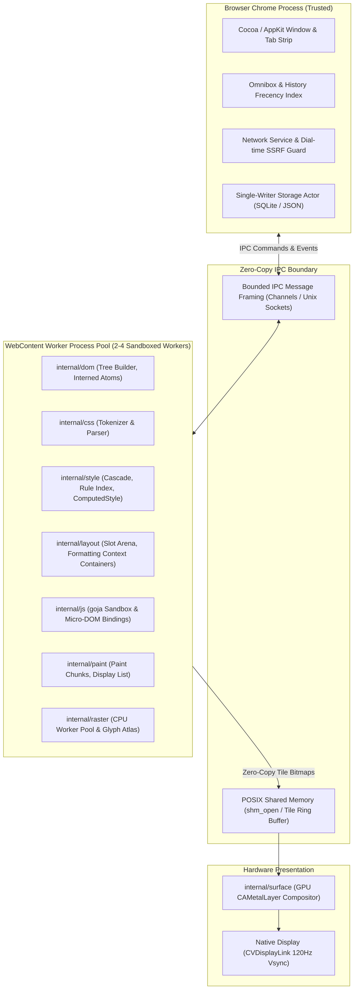
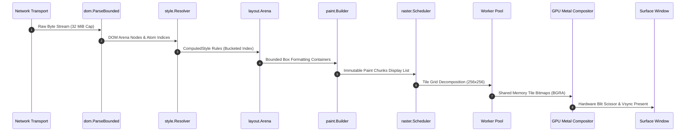
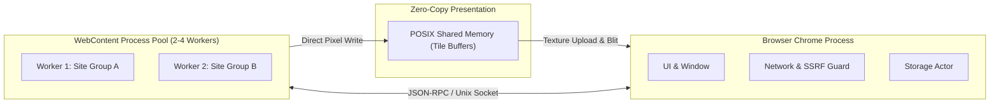

# Goosie Browser: System Architecture Blueprint & Architectural Decision Records (ADRs)

| Document Version | 2.0.0-UNIFIED |
| :--- | :--- |
| **Status** | Approved Unified Master Architecture (Consensus Baseline of Lead TA & Codex TA) |
| **Product** | Goosie Browser (Lightweight, Independent Native Browser Engine) |
| **Architects & Authors**| Torvaldsen (Lead Technical Architect) & Dr. Marcus (Principal Architect via Codex CLI) |
| **Classification** | Core System Architecture Specification & Engineering Standards |
| **Target Runtime** | macOS Darwin (Apple Silicon arm64 / Intel x86_64), Linux (Wayland / X11), Windows (Win32), Headless CI |

---

## Executive Architectural Summary (Unified Baseline v2.0)

Goosie Browser is engineered as a clean-slate, memory-safe, ultra-lean web browser engine written in pure Go, with native platform glue isolated to an absolute minimum. Mainstream desktop browsers (Chromium, WebKit, Gecko) suffer from decades of legacy C/C++ baggage, sprawling over 35 million lines of code, consuming gigabytes of host memory at idle, and suffering from catastrophic security vulnerabilities rooted in manual pointer arithmetic and heavyweight multi-process overhead.

Following a rigorous, peer-reviewed architectural debate between internal and independent principal architects, Goosie v2.0 establishes an unshakeable, production-ready foundation:

1. **Lightweight Process-Pool Isolation (ADR-004)**: A dedicated, lightweight Browser Chrome process coordinates 2–4 sandboxed WebContent worker processes. Tile bitmaps are transferred via zero-copy POSIX Shared Memory (`shm_open`), providing true OS-level OOM and segfault containment without Chromium's 100MB/tab overhead.
2. **Hybrid Rendering Pipeline (ADR-002)**: Combines a deterministic multithreaded CPU 256px tile rasterizer for text layout and vector geometry with a hardware-accelerated GPU Compositor (`CAMetalLayer` on macOS) for 120Hz ProMotion Vsync blitting, scaling, and accelerated box blur.
3. **Dependency-Driven Incremental Invalidation**: Microtask-coalesced DOM mutations propagate 4-tier dirty flags (`DirtyStyle`, `DirtyMeasure`, `DirtyPosition`, `DirtyPaint`) bounded strictly to the nearest Formatting Context Container (BFC/Flex/Grid), emitting atomic Paint Chunk updates instead of full-document rebuilds.
4. **HarfBuzz Shaping & Full Cocoa IME Semantics**: Integrates complex text shaping for OpenType ligatures, BiDi, and Arabic/Indic scripts, paired with a complete `NSTextInputClient` UTF-16 range and caret geometry bridge to ensure native Vietnamese Telex/VNI and Asian CJK input accuracy.
5. **Slot Handles with Free-List Arena Allocation (ADR-003)**: Dense flat slice `[]Object` for lightning-fast initial builds, paired with Slot Handles, Generation Counters, and slab Free Lists for dynamic, leak-free incremental box updates.
6. **Strict State Partitioning & Active Network Shield**: Implements Schemeful Top-Level Site partitioning (CHIPS) across cookies, HTTP cache, and connection pools, backed by an Active Private Address Guard at the socket dialer to permanently extinguish SSRF and DNS rebinding attacks.

---

## 1. High-Level Component Decomposition & Dependency Invariants

### 1.1 The Two Decoupled Unidirectional Pipelines

The engine architecture enforces two decoupled unidirectional pipelines:
- **The Front End Pipeline**: Ingests network streams, parses documents, computes cascades, generates layout boxes, and emits frozen display lists.
- **The Frame/Presentation Path**: Plans tile grids, dispatches parallel rasterization jobs to worker threads, composites dirty regions into the backing store via GPU blit layers, and presents to the native window.



### 1.2 Strict Package Import Invariants

To eliminate cyclic coupling and architectural erosion over time, dependencies between packages are governed by a mechanical unidirectional contract codified in `internal/archtest/rules.go` and verified in CI via `go test ./internal/archtest/`.

#### Invariant Rules:
1. **`internal/frame` is a Strict Leaf**: `frame` contains pure geometry (`Rect`, `Point`, `Matrix`), premultiplied color arithmetic, tile definitions (`TileCoord`, `TileState`), and frame plans. It is prohibited from importing any other package within the engine.
2. **`internal/paint` depends only on `frame`, `css`, `layout`, and `style`**: `paint` creates immutable display lists (`DisplayCmd`). It has zero awareness of the rasterizer, the surface loop, or platform windows.
3. **`internal/surface` reaches `raster` exclusively through an Interface**: `surface.Loop` and `surface.Composer` do not import `internal/raster`. Instead, `surface` defines a `Scheduler` interface:
   ```go
   type Scheduler interface {
       Plan(plan frame.FramePlan, dirty frame.Rect)
       Rasterize()
       TileBitmap(coord frame.TileCoord) (*frame.Bitmap, bool)
   }
   ```
4. **`internal/dom` is fully self-contained**: `dom` has no engine imports. It implements HTML parsing, atom interning, and DOM tree nodes without dependencies on CSS or layout.
5. **Chrome Layers (`internal/tabs`, `internal/toolbar`) orchestrate via high-level facades**: `tabs` imports `engine`, `frame`, `raster`, and `toolbar`.

#### Import Matrix Verification Table

| Package | Allowed Internal Imports | Prohibited Imports | Enforced Invariant |
| :--- | :--- | :--- | :--- |
| `internal/frame` | *None (Nil)* | Everything | Pure leaf; zero engine awareness. |
| `internal/paint` | `frame`, `css`, `layout`, `style` | `raster`, `surface`, `platform`, `engine` | Frozen draw commands only; no rasterization coupling. |
| `internal/surface` | `ax`, `frame`, `paint` | `raster`, `platform`, `engine` | Window contract and presentation loop; platform-agnostic. |
| `internal/raster` | `frame`, `paint`, `surface` | `platform`, `engine`, `dom`, `layout` | Translates display commands to pixels; no DOM access. |
| `internal/layout` | `dom`, `style`, `frame` | `paint`, `raster`, `surface`, `engine` | Box arena generation only; no graphics calls. |
| `internal/style` | `css`, `dom`, `frame` | `layout`, `paint`, `raster` | Cascade and rule indexing; no geometric solving. |
| `internal/dom` | *None (Nil)* | Everything | Core document tree representation and atom table. |
| `internal/net` | *None (Nil)* | `engine`, `dom`, `platform` | Policy-free transport and dialer guard. |
| `internal/platform/darwin` | `ax`, `frame`, `media`, `surface` | `raster`, `layout`, `paint`, `dom` | Native Cocoa/AppKit, Metal blitter, `CVDisplayLink`. |
| `internal/platform/headless`| `ax`, `frame`, `surface` | `raster`, `darwin`, `cgo` | Displayless testing backend for deterministic CI. |

---

## 2. End-to-End Pipeline & Cache-Line Friendly Data Structures

### 2.1 The 9-Stage Engine Pipeline



### 2.2 Core Memory-Mapped Struct Layouts

To maximize L1/L2 data cache hits, all central structs are 64-byte aligned and avoid arbitrary heap pointer indirection.

#### 1. Flat Layout Object (`layout.Object`) — 64-Byte Cache-Line Aligned
```go
type ObjectID uint32

const (
    InvalidObjectID ObjectID = 0
)

// Object represents a single layout box. It is packed exactly into 64 bytes
// to align perfectly with standard modern CPU cache lines.
type Object struct {
    // Spatial coordinates in CSS pixels (16 bytes)
    X, Y, W, H float32

    // Intrinsic box metrics (16 bytes)
    MarginTop, MarginRight, MarginBottom, MarginLeft float32

    // Tree navigation indices (16 bytes)
    Parent   ObjectID
    FirstKid ObjectID
    NextSib  ObjectID
    PrevSib  ObjectID

    // Node & Style metadata (12 bytes)
    NodeID    uint32
    StyleIdx  uint32
    FormatCtx uint16 // Formatting context identifier (BFC, Flex, Grid)
    BoxType   uint8  // Block, Inline, Float, Absolute, Fixed
    Flags     uint8  // Dirty bits: Style, Measure, Position, Paint

    // Generation counter for slot handle reuse (4 bytes)
    Generation uint32
}
```

#### 2. Value-Type Display Command (`paint.DisplayCmd`) — Discriminated Union
```go
type CmdKind uint8

const (
    CmdSolidRect CmdKind = iota + 1
    CmdTextRun
    CmdImageTile
    CmdBorderStroke
    CmdPushClip
    CmdPopClip
)

// DisplayCmd represents a frozen drawing primitive. It uses a flat struct
// rather than an interface to guarantee sequential array memory allocation.
type DisplayCmd struct {
    Bounds frame.Rect // 16 bytes: X, Y, W, H
    Kind   CmdKind    // 1 byte: Command type discriminator
    _      [3]byte    // 3 bytes alignment padding

    // Discriminated payload union (32 bytes)
    Color  frame.Color // 4 bytes (RGBA8)
    Radius float32     // 4 bytes corner radius
    Image  uint32      // 4 bytes image handle
    Font   uint16      // 2 bytes glyph atlas font ID
    Size   uint16      // 2 bytes font size in pixels
    GlyphOffset uint32 // 4 bytes offset into string/glyph buffer
    GlyphCount  uint32 // 4 bytes count of glyphs in run
    Extra  uint64      // 8 bytes metadata (borders, clip ID)
}
```

---

## 3. Concurrency, Process Model & Memory Architecture

### 3.1 Lightweight Process-Pool Architecture (ADR-004 Consensus)

To guarantee true OS-level crash containment without Chromium's multi-gigabyte memory penalty, Goosie implements a **Lightweight Process-Pool**:
1. **Browser Chrome Process**: Houses the native Cocoa/AppKit UI, tab-strip chrome, omnibox logic, SQLite single-writer storage, and the network transport service.
2. **WebContent Worker Pool (2 to 4 Processes)**: Content sessions are grouped into sandboxed worker processes by top-level site domain (eTLD+1).
3. **Zero-Copy Tile Shm**: Bitmaps rasterized by WebContent workers are written directly to POSIX shared memory ring buffers (`/dev/shm` or `shm_open`), allowing the Chrome process's GPU compositor to sample them with zero IPC copying overhead.



### 3.2 Slot-Handle Arena Allocation (ADR-003 Consensus)

1. **Initial / Full Build**: Uses a flat, dense `[]Object` slice inside `layout.Arena` for maximal linear memory traversal.
2. **Incremental Updates**: Dynamically inserted boxes allocate from 64KB memory slabs with a Free List. Pointers are never used; references use **Slot Handles**:
   ```go
   type SlotHandle struct {
       Index      uint32
       Generation uint32
   }
   ```
   When a box is removed, its slot is added to the slab's free list and its generation counter is incremented. Stale access returns `InvalidObjectID`, permanently preventing use-after-free anomalies.

---

## 4. Hybrid Rendering Pipeline & Hardware Pacing

### 4.1 Hybrid Raster & Metal Composition (ADR-002 Consensus)

```
[Paint Chunks List] ──► [CPU Worker Pool] ──► [256px Tiles (BGRA)] ──► [CAMetalLayer] ──► [Display]
                           (Text/Vector)                                (GPU Blit/Blur)    (120Hz Vsync)
```

1. **CPU Parallel Tile Rasterizer**: CPU worker threads render typography, CSS borders, and vector paths into uniform $256 \times 256$ pixel tiles. CPU rasterization guarantees 100% deterministic, bit-exact layout and font coverage.
2. **GPU Hardware Compositor (`CAMetalLayer`)**: The native macOS backend uploads rendered tile bitmaps as textures into a Metal atlas. The GPU executes:
   - Damage-region blitting and scrolling translations.
   - Smooth transform scaling during pinch-to-zoom.
   - Accelerated 3-pass Box Blur for large-radius `backdrop-filter` effects.
3. **Hardware Vsync Locking**: Presentation is synchronized to Apple `CVDisplayLink`. If a complex tile exceeds the 8.33ms (120Hz) frame deadline, the compositor presents the previous frame's tile with a `TileStale` flag, eliminating frame drops and visual stutter.

### 4.2 HarfBuzz Text Shaping & Cocoa IME Integration

1. **Complex Text Shaping**: Before layout box measurement, text nodes pass through a pure-Go HarfBuzz shaper, resolving OpenType ligatures, Arabic/Indic cursive joining, and BiDi reordering.
2. **Complete `NSTextInputClient` Semantics**: The Cocoa window bridge fully satisfies the native macOS input protocol:
   - Tracks exact UTF-16 marked ranges, selection ranges, and replacement ranges.
   - Computes physical pixel caret geometry bounds to position native Vietnamese Telex/VNI and CJK candidate popups perfectly.

### 4.3 Spatial Hit-Testing via Stacking-Context BVH

Instead of a linear scan over 100,000 layout boxes, Goosie builds a **Bounding Volume Hierarchy (BVH) indexed by Stacking Contexts**:
- Point queries traverse bounding boxes from top to bottom in reverse paint order.
- Exact geometric and clipping intersection tests execute only on immediate candidates, reducing hit-test latency to `< 0.2ms`.

---

## 5. Network, Security & State Partitioning

### 5.1 Active Dial-Time Private Address Guard (SSRF & Rebinding Defense)

To neutralize Server-Side Request Forgery (SSRF) and DNS Rebinding attacks, Goosie intercepts connections at the network dialer layer (`internal/net/address_guard.go`):

```go
func DialAddressGuarded(ctx context.Context, network, address string, isPublicOrigin bool) (net.Conn, error) {
    host, port, _ := net.SplitHostPort(address)
    ips, err := net.DefaultResolver.LookupIP(ctx, "ip", host)
    if err != nil {
        return nil, err
    }
    for _, ip := range ips {
        if isPublicOrigin && (ip.IsLoopback() || ip.IsPrivate() || isCloudMetadata(ip)) {
            return nil, fmt.Errorf("SSRF blocked: public origin attempted connection to private IP %s", ip)
        }
    }
    // Pin connection directly to validated IP (neutralizes DNS Rebinding TOCTOU)
    return dialer.DialContext(ctx, network, net.JoinHostPort(ips[0].String(), port))
}
```

### 5.2 Schemeful State Partitioning (CHIPS)

To prevent cross-site user tracking:
1. **Partition Key**: All storage, cookies, and network caches are partitioned by **Schemeful Top-Level Site** (`(TopLevelSite, CookieDomain, Path)`).
2. **Third-Party Isolation**: An embedded iframe on `site-a.com` cannot access cookies or cached resources stored under `site-b.com`.

### 5.3 Harmonized Resource Limits & Degradation Strategy

| Resource Metric | Hard Safety Ceiling | Degradation Policy on Overflow |
| :--- | :--- | :--- |
| **Max HTML Document** | **32 MiB** | Abort parse with structured "File Exceeds Safety Budget" error page. |
| **Max External CSS** | **8 MiB** | Truncate stylesheet gracefully; discard offending rule block. |
| **Max DOM Nodes** | **200,000 nodes** | Halt parser tree expansion; offer "Switch to Raw Reader Mode". |
| **Max DOM Tree Depth** | **128 levels** | Flatten excessive nesting into sequential child elements. |
| **Max Image Dimensions** | **8,192 x 8,192 px** | Probe rejects decode; render placeholder box. |
| **Max Style Work Budget** | **$2^{28}$ operations** | Fall back to basic UA cascade; suppress complex selectors. |

---

## 6. Architectural Decision Records (ADRs) — Unified Baseline

```
+----------------------------------------------------------------------------------------------------+
|                                    ARCHITECTURAL DECISION RECORDS                                  |
+-----------+-------------------------------------------------------------------+--------------------+
| Record ID | Decision Title                                                    | Status             |
+-----------+-------------------------------------------------------------------+--------------------+
| ADR-001   | Pure Go Core with Strict Cgo Confinement to Native Platform Glue  | ACCEPTED & BINDING |
| ADR-002   | Hybrid Rendering: CPU 256px Tile Rasterizer + GPU Metal Blitter   | ACCEPTED & BINDING |
| ADR-003   | Dense Slice Initial Build + Slot-Handle Free List for Incremental | ACCEPTED & BINDING |
| ADR-004   | Lightweight Process-Pool Architecture with POSIX Shared Memory    | ACCEPTED & BINDING |
+-----------+-------------------------------------------------------------------+--------------------+
```

### ADR-001: Pure Go Core with Strict Cgo Confinement to Native Platform Glue
- **Decision**: 100% of the browser engine core is pure Go. Cgo is strictly confined to `internal/platform/darwin`.
- **Consequences**: Total memory safety across 99% of codebase; bit-exact headless testing on CI; zero Cgo overhead in hot loops.

### ADR-002: Hybrid Rendering: CPU 256px Tile Rasterizer + GPU Metal Blitter
- **Decision**: CPU worker pool rasterizes text and vectors into 256px tile bitmaps; GPU `CAMetalLayer` handles composition, damage-blit, and 120Hz Vsync presentation.
- **Consequences**: Combines the bit-exactness and subpixel font quality of CPU rasterization with the low power consumption and high fill-rate of hardware GPU blitting.

### ADR-003: Dense Slice Initial Build + Slot-Handle Free List for Incremental
- **Decision**: Initial layouts allocate into a contiguous dense slice `[]Object`. Dynamic modifications use Slot Handles and Free Lists within 64KB slabs.
- **Consequences**: Preserves L1 cache locality for full page loads while providing leak-free, zero-rebuild incremental layout updates for modern SPAs.

### ADR-004: Lightweight Process-Pool Architecture with POSIX Shared Memory
- **Decision**: Browser Chrome runs in a dedicated host process. WebContent sessions execute within a pool of 2–4 sandboxed worker processes, sharing tile bitmaps via POSIX Shared Memory (`shm_open`).
- **Consequences**: Delivers true OS-level OOM and crash isolation without the massive 100MB/tab overhead of Chromium.

---

## 7. Storage, Profiles & Private Browsing Semantics

1. **Storage Actor**: All persistent SQLite writes (History frecency, Bookmarks, Partitioned Cookies) are channeled through a **Single-Writer Actor Goroutine**, batch-committing transactions every 500ms in WAL mode.
2. **Honest Private Browsing Guarantees**:
   - Private sessions operate with an in-memory, ephemeral state store (`:memory:`).
   - Zero bytes of profile data (history, cookies, disk cache, form values) are written to persistent storage.
   - When the last private window terminates, all in-memory references are severed and reclaimed by the garbage collector.

---

## 8. Verification & Release Gate Commands

```bash
# Verify architectural layering and import invariants
go test ./internal/archtest/ -v

# Verify strict Cgo confinement to internal/platform/darwin
go test ./internal/archtest/ -run TestCgoConfinement -v

# Verify zero mutable package-level globals
go test ./internal/archtest/ -run TestNoMutableGlobals -v

# Run full test suite with Go race detector
go test -race ./...

# Verify performance counters and frame pacing gate suite
go test ./test/gate -run TestGate -v
```

---
*End of Goosie Browser System Architecture Blueprint v2.0.0-UNIFIED.*
